<div align="center">
  <picture>
    <source media="(prefers-color-scheme: dark)" srcset="docs/assets/luban-wordmark-dark.svg">
    
  </picture>
  <p><a href="README.md">English</a> · <a href="README.zh-CN.md">简体中文</a></p>
  <p><strong>An embodied-agent framework across tasks, environments and robot embodiments</strong></p>
  <p><picture>
    <source media="(prefers-color-scheme: dark)" srcset="docs/assets/luban-pillars-dark.svg">
    
  </picture></p>
  <!-- project-links:start -->
  <p><a href="https://liutong-luban-project.netlify.app/">Project</a> · <a href="docs/project-page.md#arxiv">arXiv</a> · <a href="docs/atomic-skills.md">Skills</a> · <a href="docs/demo-gallery.md">Demos</a> · <a href="https://liutong-luban-project.netlify.app/offline/">Console</a> · <a href="docs/README.md">Docs</a></p>
  <!-- project-links:end -->
</div>

## Abstract

Luban connects planning, atomic-skill execution, independent verification, memory and experience updates through a task graph. Instructions, multiview observations and available skills define each node's goal, dependencies and completion criteria. Policies produce actions, and a verifier checks subsequent observations and environment feedback. Retries, replanning within a node and selective branch revision preserve progress after local failures. Multiscale memory retains observations, spatial relations and completed-node facts. Experience is evaluated through paired trials and retrieved by task, skill and embodiment conditions, supporting kitchen, tabletop, dual-arm, laboratory and navigation tasks.

## Main capabilities

| Capability | Role |
| --- | --- |
| Agent assembly | Compose Planner, Policy, Verifier and Memory for the robot, sensors, environment and available skills. |
| Task graphs and node planning | Generate dependencies and completion criteria, then select node instructions from current observations and memory. |
| Atomic-skill calls | Organize reusable operations through parameters, capability requirements, preconditions, budgets and execution feedback. |
| Verification and recovery | Check post-action conditions and recover through retries, node replanning or revision of the blocked branch. |
| Node and spatial memory | Preserve verified progress and expose entities, locations and spatial relations to subsequent planning. |
| Experience evolution | Extract candidates, validate them with paired trials, retrieve applicable experience and update it from new feedback. |
| Multi-environment evaluation | Connect RoboCasa365, RoboTwin, LIBERO, RoboSynChallenge and Chemistry environment and policy interfaces. |

## Atomic skills: 64 capabilities across nine domains

Atomic skills turn sensing and action into bounded operations with explicit inputs, preconditions, budgets and completion criteria. The planner selects a skill and its parameters; the verifier checks observations and environment state before the next step. The 64 skills span nine domains and can be composed when robot capabilities and state preconditions match.

One animated example per domain is shown below. Open a GIF at full size, or explore all 64 skills with names, call identifiers and recording types in the gallery.

Perception 12 · Motion control 11 · Grasping and grippers 8 · Object interaction 9 · Articulated objects 6 · Tool use 2 · Navigation 6 · Flight control 8 · Gimbals and payloads 2

<table>
<tr>
<td width="33%" align="center" valign="top">
<a href="docs/assets/skills/gifs/P05.gif">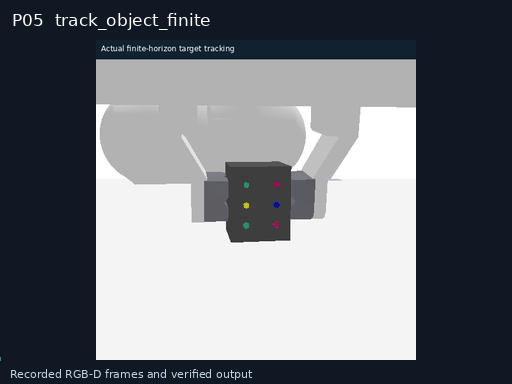</a><br>
<strong>P05 · Finite-horizon object tracking</strong><br>
<sub>Recorded input / output</sub>
</td>
<td width="33%" align="center" valign="top">
<a href="docs/assets/skills/gifs/M01.gif">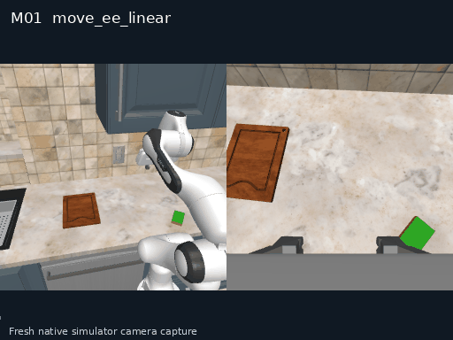</a><br>
<strong>M01 · Linear end-effector motion</strong><br>
<sub>Simulator capture</sub>
</td>
<td width="33%" align="center" valign="top">
<a href="docs/assets/skills/gifs/G05.gif">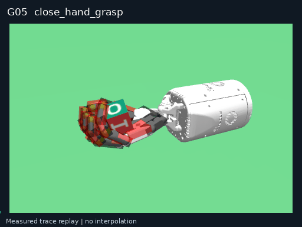</a><br>
<strong>G05 · Parameterized dexterous grasp</strong><br>
<sub>Measured trace replay</sub>
</td>
</tr>
<tr>
<td width="33%" align="center" valign="top">
<a href="docs/assets/skills/gifs/I10.gif">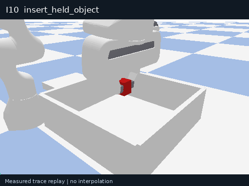</a><br>
<strong>I10 · Straight held-object insertion</strong><br>
<sub>Measured trace replay</sub>
</td>
<td width="33%" align="center" valign="top">
<a href="docs/assets/skills/gifs/A07.gif">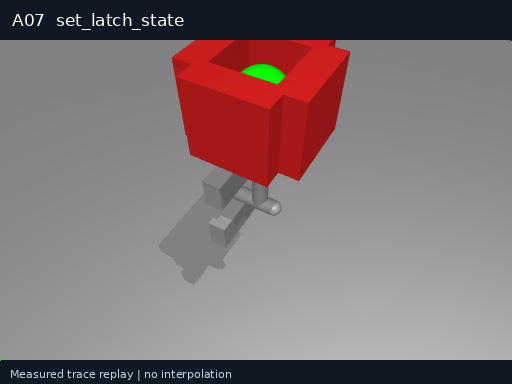</a><br>
<strong>A07 · Mechanical latch operation</strong><br>
<sub>Measured trace replay</sub>
</td>
<td width="33%" align="center" valign="top">
<a href="docs/assets/skills/gifs/T04.gif">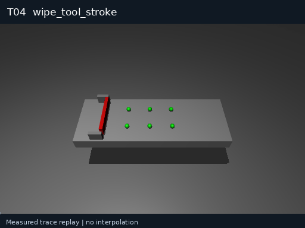</a><br>
<strong>T04 · Single tool-wiping stroke</strong><br>
<sub>Measured trace replay</sub>
</td>
</tr>
<tr>
<td width="33%" align="center" valign="top">
<a href="docs/assets/skills/gifs/N05.gif">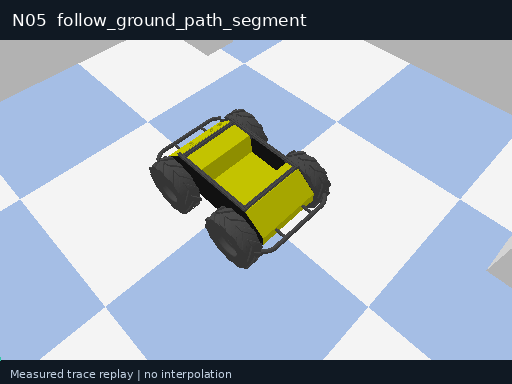</a><br>
<strong>N05 · Ground-path segment following</strong><br>
<sub>Measured trace replay</sub>
</td>
<td width="33%" align="center" valign="top">
<a href="docs/assets/skills/gifs/F05.gif">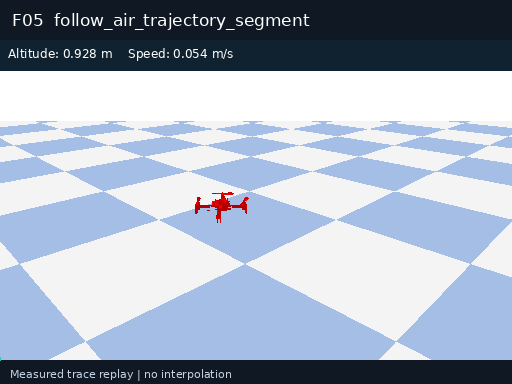</a><br>
<strong>F05 · 3D trajectory-segment following</strong><br>
<sub>Measured trace replay</sub>
</td>
<td width="33%" align="center" valign="top">
<a href="docs/assets/skills/gifs/U01.gif">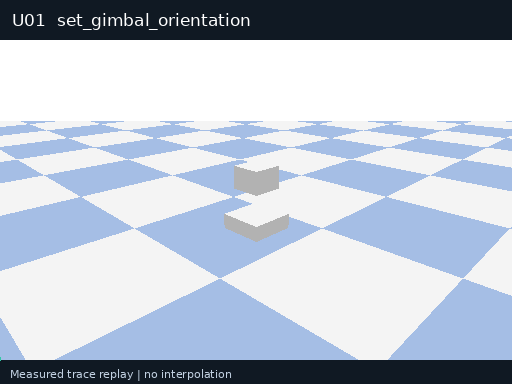</a><br>
<strong>U01 · Gimbal orientation control</strong><br>
<sub>Measured trace replay</sub>
</td>
</tr>
</table>

GIFs are the 2026-10-27 v2.4 demonstration snapshot, labeled as simulator capture, recorded input/output or measured trace replay. The gallery explains the five constrained perception demos and the later v2.5 evaluation.

[Explore all 64 skills and composition examples](docs/atomic-skills.md) · [Three-round call evaluation](docs/reported-results.md#atomic-call-evaluation)

## Demos across tasks, environments and embodiments

Click a preview to watch the full recording. [More physical and simulated demonstrations](docs/demo-gallery.md).

<table>
<tr><td width="50%" valign="top"><strong>M20 indoor navigation</strong><br><br><a href="docs/assets/demos/m20-indoor-en.mp4">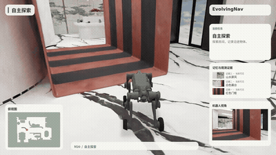</a><br>Physical robot trajectory replay with exploration, memory and goal arrival.<br><a href="docs/assets/demos/m20-indoor-en.mp4">Watch full video</a></td><td width="50%" valign="top"><strong>M20 outdoor navigation</strong><br><br><a href="docs/assets/demos/m20-outdoor-en.mp4">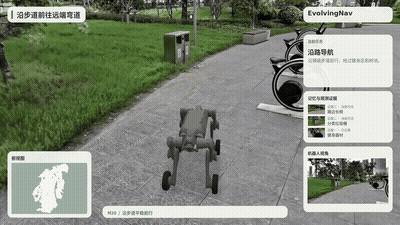</a><br>Physical robot trajectory replay with path following and scene observations.<br><a href="docs/assets/demos/m20-outdoor-en.mp4">Watch full video</a></td></tr>
<tr><td width="50%" valign="top"><strong>RoboTwin dual-arm handover</strong><br><br><a href="docs/assets/demos/robotwin_handover_mic.mp4">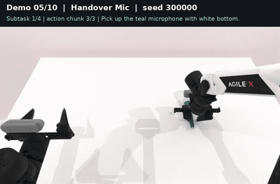</a><br>Dual-arm simulation: establish the receiving grasp before release.<br><a href="docs/assets/demos/robotwin_handover_mic.mp4">Watch full video</a></td><td width="50%" valign="top"><strong>Chemistry titration simulation</strong><br><br><a href="docs/assets/demos/chemistry-titration.mp4">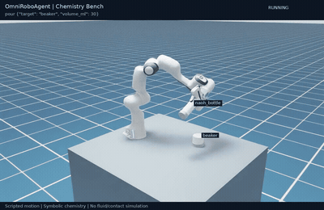</a><br>Scripted Isaac Sim workflow: pick, pour, inspect color and return.<br><a href="docs/assets/demos/chemistry-titration.mp4">Watch full video</a></td></tr>
</table>

## Node-level experience reuse

In a paired StirVegetables example with the same task, seed and XR-1 policy, the control episode exhausted 6,000 environment steps without completion, while the experience condition completed in 1,018 steps. Retrieved experience entered the planner context for placing broccoli in the pot. The failed clip plays at 3× speed and the successful clip at its original speed.

[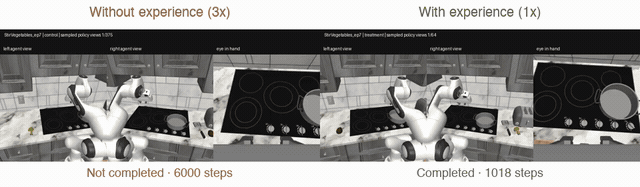](docs/assets/demos/self-evolution-comparison.mp4)

## Leaderboard

Success rates are grouped by benchmark and test setting. RoboTwin covers 50 tasks and 5,000 episodes. LIBERO covers four suites and 2,000 original episode IDs. See the [evaluation definitions](docs/reported-results.md) for the complete protocol.

### Atomic-skill and composition call results

| Evaluation | Scale | Passed / attempted | Overall pass rate | Lowest item in one round |
| --- | --- | ---: | ---: | ---: |
| Independent atomic skills | 64 skills × 50 trials × 3 rounds | 9,582 / 9,600 | **99.81%** | **96%** |
| Composed programs | 25 programs × 50 trials × 3 rounds | 3,749 / 3,750 | **99.97%** | **98%** |

These are controlled-simulation results from the independent evaluator's v2.5 campaign on 2026-10-28. Every item in every round meets the atomic >90% and composition ≥60% thresholds, with all 19 failures retained. [Round-by-round counts, settings and evidence](docs/reported-results.md#atomic-call-evaluation).

### Additional experiments from the technical report

| Research question | Evaluation scale | Reported result |
| --- | --- | --- |
| RoboTwin planning quality | 250 plans, 785 aligned slots | 99.20% parseability, 88.28% skill match, 0.222-chunk budget MAE |
| RoboCasa experience retrieval | 470 valid episode pairs | 278 → 294 successes, 59.15% → 62.55%, +3.40 percentage points |
| LIBERO agent support | 2,000 original episode IDs per condition | 1,934 → 1,978 completed IDs, 96.7% → 98.9% |
| Physical-robot streaming execution | 40 episodes per setting | Waiting: StreamVLN 7.32 → 1.63 s; NaVIDA 10.64 → 2.89 s |

See the [full report results](docs/reported-results.md#report-details) for planning metrics, paired outcomes, LIBERO execution budgets and navigation endpoint counts. These experiments evaluate plan quality, task completion and execution efficiency separately.

### RoboCasa365

| Method | Atomic seen (%) | Composed seen (%) | Composed unseen (%) |
| --- | --- | --- | --- |
| DP | 15.7 | 0.2 | 1.3 |
| π0 | 34.6 | 6.1 | 1.1 |
| π0.5 | 39.6 | 7.1 | 1.2 |
| GR00T-N1.6 | 51.1 | 9.4 | 1.7 |
| XR-1 | 80.2 | 57.1 | 32.1 |
| Luban / XR-1 (w/o evolution) | 82.1 | 65.0 | — |
| Luban / XR-1 | 85.5 | 68.6 | — |

### RoboTwin 2.0

| Method | Training | Clean (%) | Random (%) |
| --- | --- | --- | --- |
| π0.5 | Multi-task | 70.70 | 46.00 |
| Luban / Qwen + π0.5 | Multi-task | 61.58 | — |
| DP3 | Single-task | 55.24 | 4.96 |
| π0 | Single-task | 46.42 | 16.34 |
| RDT-1B | Single-task | 34.50 | 13.72 |
| ACT | Single-task | 29.74 | 1.74 |
| DP | Single-task | 28.04 | 0.64 |

### LIBERO

| Method | Spatial (%) | Object (%) | Goal (%) | LIBERO-10 (%) | Mean (%) |
| --- | --- | --- | --- | --- | --- |
| DP | 78.3 | 92.5 | 68.3 | 50.5 | 72.4 |
| OpenVLA | 84.7 | 88.4 | 79.2 | 53.7 | 76.5 |
| π0 | 96.8 | 98.8 | 95.8 | 85.2 | 94.2 |
| OpenVLA-OFT (without Agent) | 97.6 | 97.4 | 98.4 | 93.4 | 96.7 |
| Luban / OpenVLA-OFT | 99.4 | 99.2 | 99.4 | 97.6 | 98.9 |

On RoboCasa365, the full framework exceeds XR-1 by 11.5 percentage points on composed-seen tasks and 5.3 points on atomic-seen tasks. RoboTwin reference rows retain their respective training settings, with Luban completing 3,079/5,000 Clean episodes. The LIBERO OpenVLA-OFT row is the project control condition, and Luban completes 1,978/2,000 original IDs. Execution budgets are detailed in the results guide. “—” means unreported.

RoboSynChallenge completes **412/1,000 episodes (41.2%)** across ten tasks with unfiltered seeds. In **470 valid RoboCasa pairs**, experience retrieval raises success from **59.15% to 62.55%**. Spatial memory parses 16 entities in one scene and supports subsequent queries in approximately **0.15 ms**.

## Project and demonstration console

[Open the project page](https://liutong-luban-project.netlify.app/) and select the demonstration console, or [open the console directly](https://liutong-luban-project.netlify.app/offline/). The console is integrated into the project site and pairs video with task decomposition, atomic-skill calls, verification and recovery. See the [console guide](docs/reader-console.md).

## Architecture

[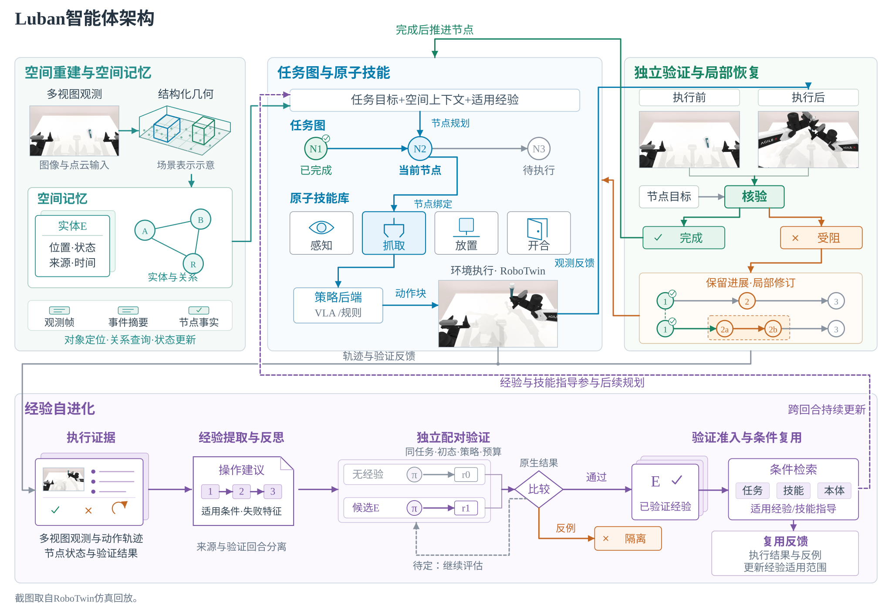](docs/assets/luban-framework.svg)

## Compute requirements

The CPU quickstart and remote-model clients can run without a local GPU. Simulation and local model serving have their own resource budgets, described in the [compute and storage guide](docs/installation.md#compute-and-storage-requirements).

The separate [complete atomic-skill evaluator](https://github.com/yuliu-ai/atomic-skill-evaluator) currently uses two 48 GB-class NVIDIA GPUs, each with at least 40,000 MiB free, Linux x86_64, glibc >=2.35 and driver >=580. Initial installation needs 120 GiB free; the default three-round run checks another approximately 226 GB of output capacity after installation, with 350 GB initially free recommended. CPU and system-RAM minimums have not been measured; simulation concurrency defaults to 4 and supports 1 through 8.

## Install and run on CPU

Prerequisites: Python **3.11**, [uv](https://docs.astral.sh/uv/getting-started/installation/)
and repository access. The tested host is Ubuntu 22.04.5.

```bash
git clone --branch codex/private-readiness --single-branch https://github.com/Luban-Agents/Luban.git
cd Luban
uv sync --frozen --no-dev --python 3.11
uv run --frozen --no-dev python -m luban.examples.offline
uv run --frozen --no-dev luban run --config configs/runs/offline.yaml
```

Expect two `increment` actions, `success: true` and
`termination_reason: task_success`. Results appear under
`runs/offline_demo/<session_id>/` and `runs/offline_config/<session_id>/`.
This checks installation and software flow using a mock counter.

For Conda or pip installation, distribution packages and external resources,
follow [installation](docs/installation.md). The checked-in lock is maintained
from project requirements, not exported from a shared server environment.

## Verify on a new machine

The full CPU check includes optional clients, Dashboard, HDF5 replay and CPU tensor
storage. It needs FFmpeg/ffprobe for video checks, but no GPU or API credentials.
Torch is confined to the optional `full-test` group and uses CPU wheels on Linux/Windows.

```bash
uv sync --frozen --all-extras --group dev --group docs --group full-test --python 3.11
REQUIRE_NO_SKIPS=1 bash scripts/ci.sh
.venv/bin/mkdocs build --strict
.venv/bin/python scripts/check_distribution.py
```

[New-machine instructions](docs/new-machine.md) cover repository authentication,
prerequisites, expected outputs and the difference between software checks and a
real simulation. The [CI workflow template](.github/workflow-templates/ci.yml) uses a fresh Ubuntu
runner, read-only repository permissions and no private service credentials. This milestone repository keeps it as a template because the publishing authorization does not include workflow updates; run scripts/ci.sh for validation.

## GPU simulation and policy inference

First prepare the simulator, licensed assets and independent policy service in
[installation](docs/installation.md), then use the complete
[episode guide](docs/episodes.md). With `SIM_PYTHON` and
`LUBAN_ROBOCASA_ROOT` set to your installation:

```bash
export MUJOCO_GL=egl PYOPENGL_PLATFORM=egl
export CUDA_VISIBLE_DEVICES=0 MUJOCO_EGL_DEVICE_ID=0
"$SIM_PYTHON" -m luban health --agent-config configs/agents/xr1_simple.yaml
"$SIM_PYTHON" -m luban run --config configs/runs/robocasa_simple.yaml
```

The service listens on `127.0.0.1:18400` in `planner_subtask` / `episode_step`
mode. The example fixes `CloseBlenderLid`, target split, index 0, seed 7,
600 environment steps, 38 chunks and a 600-second runtime budget. A deterministic
planner selects the native instruction; XR-1 produces real actions. This example
does not use an LLM planner.

The fresh simulator-environment run ended with native `task_success`, 352 environment steps,
22 chunks and zero exceptions. It produced a trace, result, artifact manifest and
video. This single episode is an execution check, not a success-rate estimate.
CLI exit 0 alone does not indicate task success; inspect `result.json`.

See the optional [multimodal task-graph episode](docs/advanced-episode.md) for the
existing integrated ScrubCuttingBoard catalog and a bounded model-driven entry.

## Configure and inspect

| Location | Purpose |
| --- | --- |
| [`configs/agents/`](configs/agents) | Agent components, backend and memory |
| [`configs/runs/`](configs/runs) | Environment, task, pipeline, budgets and recorder |
| [`catalogs/`](catalogs) | Atomic-skill contracts, example bundles and historical fixtures |
| `runs/<experiment>/<session_id>/` | New results, traces and optional video; ignored by Git |

YAML uses `class_path` / `init_args` matching actual constructors. `${NAME}` and
`${NAME:-default}` expand during loading. `.env` is not loaded automatically;
export variables explicitly. The HTTP backend reads `OPENAI_API_KEY` from the
environment. [Configuration](docs/configuration.md) lists defaults and path rules;
[models and policies](docs/models.md) explains observations, action schemas and
the optional live-model counter example.

## Milestone evaluation and platform integration

The [milestone guide](docs/milestone-2026-12.zh-CN.md) covers indicators 1.2, 1.7, 1.8 and 6.1. `scripts/milestone/bootstrap.py` prepares six isolated environments and resources. `run_suite.py` runs fixed atomic skills, compositions, four physical disturbances, 100 paired RoboCasa episodes, 50 paired VLABench episodes and HTTP checks. Long-horizon comparison uses Luban dual branches and XR-1. The four disturbance tests use the M12 visual-servo configuration. `luban serve` exposes core episodes, task-graph validation and registered task execution.

## Documentation

Every detailed guide is available in English and 简体中文; switch languages at the top of a guide.

| Get started | Run and integrate | Maintain and review |
| --- | --- | --- |
| [Quickstart](docs/quickstart.md) | [Episodes](docs/episodes.md) | [Development and tests](docs/development.md) |
| [New machine](docs/new-machine.md) | [Models and policies](docs/models.md) | [Project & demo](docs/project-page.md) |
| [Installation and resources](docs/installation.md) | [Environment/robot adapters](docs/environments.md) | [Source provenance](docs/provenance.md) |
| [Configuration](docs/configuration.md) | [Logs and results](docs/results.md) | [Third-party notices](THIRD_PARTY_NOTICES.md) |
| [Troubleshooting](docs/troubleshooting.md) | [Existing research configs](configs/README.md) | [Project-page references](docs/project-page-references.md) |

For cloning and edit locations, see [Access and editing](docs/access.md).


## Contributing and license

See [CONTRIBUTING.md](CONTRIBUTING.md), [LICENSE](LICENSE), [NOTICE](NOTICE) and
[third-party notices](THIRD_PARTY_NOTICES.md). Original source attribution is retained in [provenance](docs/provenance.md).

## Citation and Acknowledgement

**Citation — Coming soon.** The final paper title, authors, arXiv identifier and
BibTeX will be supplied when ready. Current software provenance is in [CITATION.md](CITATION.md).

**Acknowledgement — Coming soon.** Collaborator, institution and funding details
will be added before release. Existing code and resource attribution remains in
[NOTICE](NOTICE) and [third-party notices](THIRD_PARTY_NOTICES.md).
