<div align="center">
  <picture>
    <source media="(prefers-color-scheme: dark)" srcset="docs/assets/liutong-wordmark-dark.svg">
    
  </picture>
  <p><a href="README.md">English</a> · <a href="README.zh-CN.md">简体中文</a></p>
  <p><strong>跨任务、跨环境、跨本体的具身智能体框架</strong></p>
  <p><picture>
    <source media="(prefers-color-scheme: dark)" srcset="docs/assets/luban-pillars-dark.svg">
    
  </picture></p>
  <!-- project-links:start -->
  <p><a href="https://liutong-luban-project.netlify.app/">Project</a> · <a href="docs/project-page.zh-CN.md#arxiv">arXiv</a> · <a href="docs/atomic-skills.zh-CN.md">原子技能</a> · <a href="docs/demo-gallery.zh-CN.md">Demos</a> · <a href="https://liutong-luban-project.netlify.app/offline/">Console</a> · <a href="docs/README.zh-CN.md">Docs</a></p>
  <!-- project-links:end -->
</div>

## 摘要

六通智能体（Luban）以任务图连接规划、原子技能执行、独立验证、记忆与自进化。系统依据任务指令、多视图观测和可用技能，为每个节点定义目标、依赖与完成条件，再由动作策略执行、验证器核对环境反馈。遇到局部失败时，通过重试、节点内重规划或分支修订接续已有进展。多尺度记忆保留观测、空间关系和节点完成事实，跨回合经验经配对验证后按任务、技能与本体能力检索，支撑厨房、桌面、双臂、实验室和导航任务。

## 主要能力

| 能力 | 作用 |
| --- | --- |
| 智能体装配 | 依据机器人、传感器、环境和可用技能组合 Planner、Policy、Verifier 与 Memory。 |
| 任务图与节点规划 | 从目标生成带依赖和完成判据的任务图，结合当前观测与记忆选择节点指令。 |
| 原子技能调用 | 以参数、能力要求、前置条件、预算和执行反馈组织技能，按任务组合与复用。 |
| 独立验证与恢复 | 动作后检查完成条件，按失败范围执行重试、节点内重规划或受阻分支修订。 |
| 节点与空间记忆 | 跨节点保留已验证进度，将场景实体、位置和空间关系提供给后续规划。 |
| 经验自进化 | 从执行中提取候选经验，经配对验证、条件检索与反馈更新后参与后续任务。 |
| 多环境评测 | 连接 RoboCasa365、RoboTwin、LIBERO、RoboSynChallenge 与 Chemistry 等环境和策略接口。 |

## 原子技能：64 项能力，9 个功能域

原子技能将感知和动作封装为有明确输入、前置条件、执行预算及完成判据的有限操作。Planner选择技能与参数，执行后由Verifier依据观测和环境状态判断结果，再将输出交给后续步骤。64项技能覆盖9个功能域，可以在满足本体能力和状态前提时组合成连续任务。

以下9项各代表一个功能域，点击动图可查看原尺寸。完整图库包含全部64项的名称、用途、调用标识和记录类型。

感知 12 · 运动控制 11 · 抓取与夹爪 8 · 物体交互 9 · 机构与开关 6 · 工具使用 2 · 导航与定位 6 · 飞行控制 8 · 云台与载荷 2

<table>
<tr>
<td width="33%" align="center" valign="top">
<a href="docs/assets/skills/gifs/P05.gif">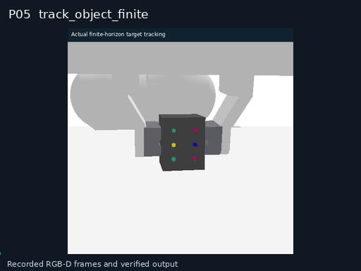</a><br>
<strong>P05 · 有限时域目标跟踪</strong><br>
<sub>观测与输出记录</sub>
</td>
<td width="33%" align="center" valign="top">
<a href="docs/assets/skills/gifs/M01.gif">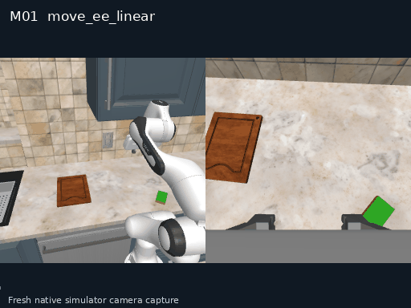</a><br>
<strong>M01 · 末端参数化直线移动</strong><br>
<sub>仿真相机实录</sub>
</td>
<td width="33%" align="center" valign="top">
<a href="docs/assets/skills/gifs/G05.gif">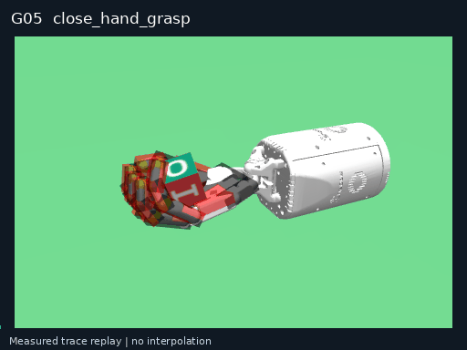</a><br>
<strong>G05 · 灵巧手参数化抓取闭合</strong><br>
<sub>实测轨迹回放</sub>
</td>
</tr>
<tr>
<td width="33%" align="center" valign="top">
<a href="docs/assets/skills/gifs/I10.gif">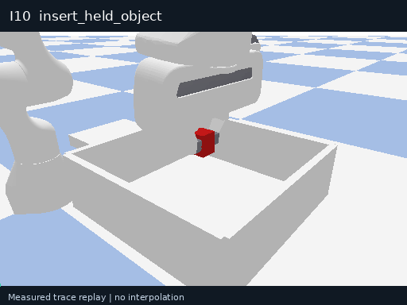</a><br>
<strong>I10 · 被持物体直线插入</strong><br>
<sub>实测轨迹回放</sub>
</td>
<td width="33%" align="center" valign="top">
<a href="docs/assets/skills/gifs/A07.gif">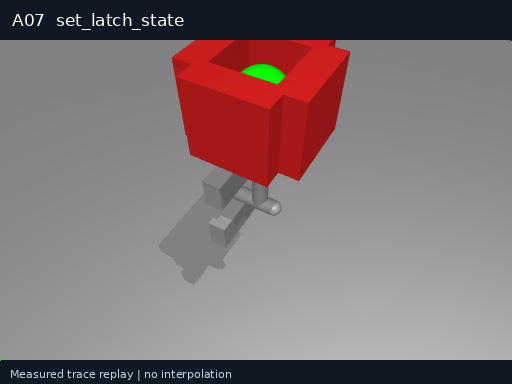</a><br>
<strong>A07 · 机械卡扣状态调节</strong><br>
<sub>实测轨迹回放</sub>
</td>
<td width="33%" align="center" valign="top">
<a href="docs/assets/skills/gifs/T04.gif">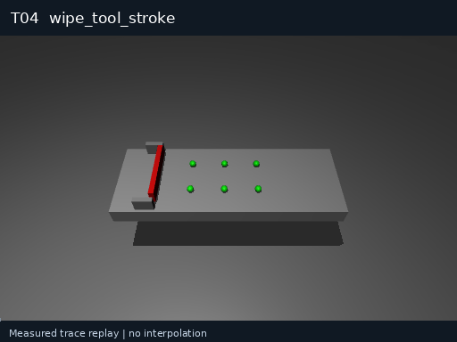</a><br>
<strong>T04 · 工具单次擦拭行程</strong><br>
<sub>实测轨迹回放</sub>
</td>
</tr>
<tr>
<td width="33%" align="center" valign="top">
<a href="docs/assets/skills/gifs/N05.gif">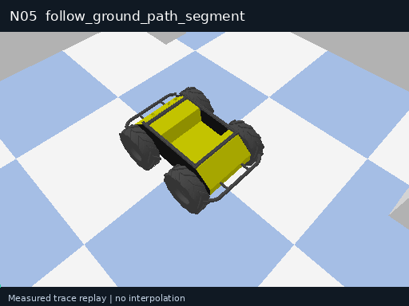</a><br>
<strong>N05 · 地面有限路径段跟随</strong><br>
<sub>实测轨迹回放</sub>
</td>
<td width="33%" align="center" valign="top">
<a href="docs/assets/skills/gifs/F05.gif">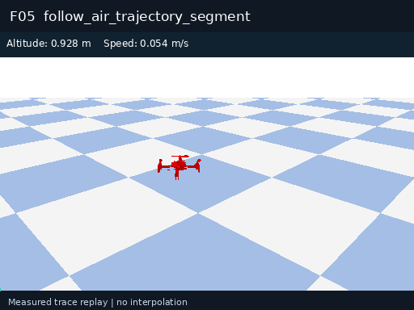</a><br>
<strong>F05 · 三维有限轨迹段跟随</strong><br>
<sub>实测轨迹回放</sub>
</td>
<td width="33%" align="center" valign="top">
<a href="docs/assets/skills/gifs/U01.gif">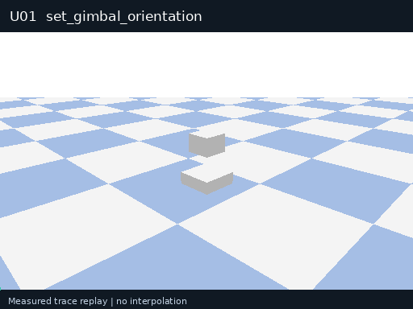</a><br>
<strong>U01 · 观测云台姿态调节</strong><br>
<sub>实测轨迹回放</sub>
</td>
</tr>
</table>

动图取自2026-10-27的v2.4演示，分别标注仿真实录、观测输出或实测轨迹回放。五项感知演示的输入约束与后续v2.5评测配置见完整图库。

[浏览全部64项技能与组合示例](docs/atomic-skills.zh-CN.md) · [查看三轮调用评测](docs/reported-results.zh-CN.md#atomic-call-evaluation)

## 跨任务、跨环境、跨本体演示

点击预览可打开完整录像。[更多真机与仿真演示](docs/demo-gallery.zh-CN.md)。

<table>
<tr><td width="50%" valign="top"><strong>M20 室内导航</strong><br><br><a href="docs/assets/demos/m20-indoor-zh.mp4">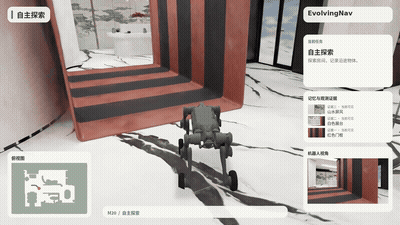</a><br>真机轨迹可视化回放，展示探索、记忆与目标到达。<br><a href="docs/assets/demos/m20-indoor-zh.mp4">观看完整视频</a></td><td width="50%" valign="top"><strong>M20 室外导航</strong><br><br><a href="docs/assets/demos/m20-outdoor-zh.mp4">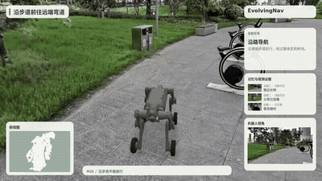</a><br>真机轨迹可视化回放，展示沿路行进与场景观察。<br><a href="docs/assets/demos/m20-outdoor-zh.mp4">观看完整视频</a></td></tr>
<tr><td width="50%" valign="top"><strong>RoboTwin 双臂交接</strong><br><br><a href="docs/assets/demos/robotwin_handover_mic.mp4">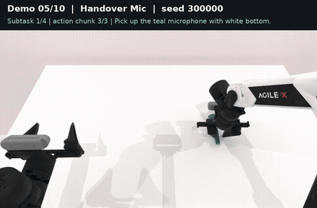</a><br>双臂仿真，先建立接握，再释放供给侧夹爪。<br><a href="docs/assets/demos/robotwin_handover_mic.mp4">观看完整视频</a></td><td width="50%" valign="top"><strong>化学滴定仿真</strong><br><br><a href="docs/assets/demos/chemistry-titration.mp4">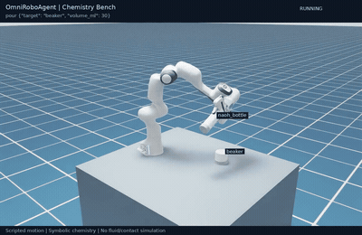</a><br>Isaac Sim 预设流程，取瓶、倾倒、观察显色并归位。<br><a href="docs/assets/demos/chemistry-titration.mp4">观看完整视频</a></td></tr>
</table>

## 节点经验复用

在 StirVegetables 的同任务、同种子与 XR-1 策略配对中，对照回合用完 6,000 环境步仍未完成，加入经验的回合在 1,018 步完成。经验进入 Planner 的西兰花入锅节点，为后续动作选择提供上下文。左侧失败片段为三倍速，右侧成功片段为原速。

[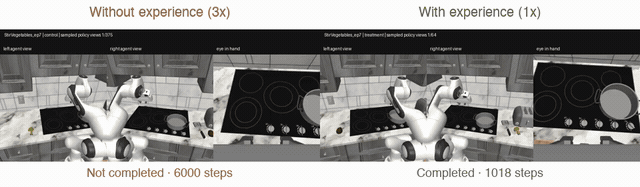](docs/assets/demos/self-evolution-comparison.mp4)

## Leaderboard · 实验结果

成功率按基准和测试设置分别列示。RoboTwin 覆盖 50 类任务、5,000 回合，LIBERO 覆盖四套件、2,000 个原始回合 ID。完整统计定义见[实验结果说明](docs/reported-results.zh-CN.md)。

### 原子技能与组合调用结果

| 评测对象 | 规模 | 成功 / 调用 | 总通过率 | 最低单项单轮 |
| --- | --- | ---: | ---: | ---: |
| 独立原子技能 | 64项 × 50次 × 3轮 | 9,582 / 9,600 | **99.81%** | **96%** |
| 组合程序 | 25组 × 50次 × 3轮 | 3,749 / 3,750 | **99.97%** | **98%** |

以上为2026-10-28独立评测包v2.5的受控仿真结果，全部单项各轮达到原子技能>90%、组合≥60%的要求，19次失败保留。[逐轮统计、配置与证据](docs/reported-results.zh-CN.md#atomic-call-evaluation)。

### 科技报告补充实验

| 研究内容 | 评价规模 | 报告结果 |
| --- | --- | --- |
| RoboTwin规划质量 | 250条计划、785个对齐槽位 | 可解析率99.20%，技能匹配率88.28%，预算MAE 0.222个动作块 |
| RoboCasa经验检索 | 470对共同有效回合 | 278 → 294次成功，59.15% → 62.55%，净增3.40个百分点 |
| LIBERO智能体支持 | 每组2,000个原始回合ID | 1,934 → 1,978个完成ID，96.7% → 98.9% |
| 真机导航流式执行 | 每种设置40回合 | StreamVLN等待7.32 → 1.63秒，NaVIDA等待10.64 → 2.89秒 |

规划指标、经验配对结局、LIBERO执行预算与导航到达成功数见[完整报告结果](docs/reported-results.zh-CN.md#report-details)。这些结果分别衡量计划质量、任务完成和执行效率。

### RoboCasa365

| 方法 | Atomic seen (%) | Composed seen (%) | Composed unseen (%) |
| --- | --- | --- | --- |
| DP | 15.7 | 0.2 | 1.3 |
| π0 | 34.6 | 6.1 | 1.1 |
| π0.5 | 39.6 | 7.1 | 1.2 |
| GR00T-N1.6 | 51.1 | 9.4 | 1.7 |
| XR-1 | 80.2 | 57.1 | 32.1 |
| 六通智能体 / XR-1 （无自进化） | 82.1 | 65.0 | — |
| 六通智能体 / XR-1 | 85.5 | 68.6 | — |

### RoboTwin 2.0

| 方法 | 训练设置 | Clean (%) | Random (%) |
| --- | --- | --- | --- |
| π0.5 | 多任务联合训练 | 70.70 | 46.00 |
| 六通智能体 / Qwen + π0.5 | 多任务联合训练 | 61.58 | — |
| DP3 | 单任务微调 | 55.24 | 4.96 |
| π0 | 单任务微调 | 46.42 | 16.34 |
| RDT-1B | 单任务微调 | 34.50 | 13.72 |
| ACT | 单任务微调 | 29.74 | 1.74 |
| DP | 单任务微调 | 28.04 | 0.64 |

### LIBERO

| 方法 | Spatial (%) | Object (%) | Goal (%) | LIBERO-10 (%) | 平均 (%) |
| --- | --- | --- | --- | --- | --- |
| DP | 78.3 | 92.5 | 68.3 | 50.5 | 72.4 |
| OpenVLA | 84.7 | 88.4 | 79.2 | 53.7 | 76.5 |
| π0 | 96.8 | 98.8 | 95.8 | 85.2 | 94.2 |
| OpenVLA-OFT (without Agent) | 97.6 | 97.4 | 98.4 | 93.4 | 96.7 |
| 六通智能体 / OpenVLA-OFT | 99.4 | 99.2 | 99.4 | 97.6 | 98.9 |

RoboCasa365 完整框架相对 XR-1 的已见复合任务提高 11.5 个百分点，已见原子任务提高 5.3 个百分点。RoboTwin 的公开参考保留各自训练设置，Luban 的 Clean 结果为 3,079/5,000。LIBERO 的 OpenVLA-OFT 行为本项目对照组，Luban 为 1,978/2,000，执行预算见结果说明。表中的“—”表示未报告。

RoboSynChallenge 在 10 类任务、1,000 个未过滤种子回合中完成 412 次，完成率为 **41.2%**。RoboCasa 的 470 对共同有效回合中，经验检索将成功率从 **59.15%** 提高至 **62.55%**。空间记忆单场景解析得到 16 个实体，后续查询约 **0.15 ms**。

## 项目页与演示控制台

[打开项目页](https://liutong-luban-project.netlify.app/)，从首页的演示控制台入口进入，也可[直接打开控制台](https://liutong-luban-project.netlify.app/offline/)。控制台已合并到项目站内，可结合视频查看任务分解、原子技能调用、验证与恢复。[控制台说明](docs/reader-console.zh-CN.md)。

## 系统架构

[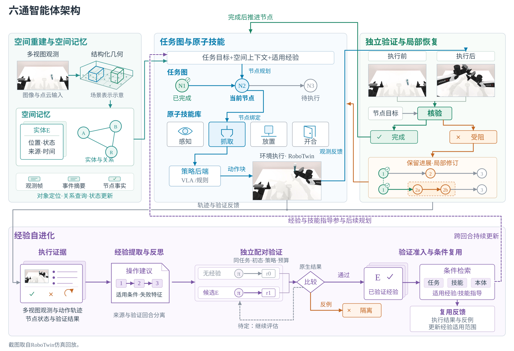](docs/assets/liutong-framework.svg)

## 算力要求

框架核心、CPU离线示例、目录查询和历史结果查看使用Python 3.11即可，相关流程不要求本机GPU。通过远程API调用模型时，模型推理算力由服务端承担，本机仿真与模型服务的资源分别计算。

完整64项原子技能与25组组合的本地评测使用独立的[atomic-skill-evaluator](https://github.com/yuliu-ai/atomic-skill-evaluator)交付包。当前配置按两张48GB级NVIDIA GPU准备，启动时每张卡须至少有40,000MiB空闲显存、没有其他CUDA计算进程，利用率低于10%。配套冻结运行包要求Linux x86_64、glibc≥2.35及NVIDIA driver≥580，Ubuntu 22.04为已验证系统。该配置同时驻留三路Qwen3-VL-8B及SAM3、深度模型，单张20GB或24GB卡超出现有完整入口的运行范围。

首次安装为下载缓存与运行环境保留至少120GiB空闲空间，默认三轮各50次在环境安装完成后还会检查约226GB可用输出空间，因此整机部署建议初始预留350GB。2026-10-28的191GiB节点使用已配置的兼容环境和专用逐轮无损归档流程完成三轮，该实例的磁盘占用对应其归档方式，通用入口按保留全部原始输出估算空间。

完整评测入口默认仿真并发数为4，支持1至8，本次三轮实测使用8。CPU核数与系统内存目前没有自动校验门槛，也未做最低配置测试，部署时应结合模型服务和并发规模配置主机资源。 [完整算力与存储说明](docs/installation.zh-CN.md#算力与存储要求)包含并发配置和实测部署范围。

## CPU 安装与首次运行

需要 Python **3.11**、[uv](https://docs.astral.sh/uv/getting-started/installation/)
和仓库访问权限。已验证 Ubuntu 22.04.5。

```bash
git clone --branch codex/private-readiness --single-branch https://github.com/Luban-Agents/Luban.git
cd Luban
uv sync --frozen --no-dev --python 3.11
uv run --frozen --no-dev python -m luban.examples.offline
uv run --frozen --no-dev luban run --config configs/runs/offline.yaml
```

预期执行两次 `increment`，得到 `success: true` 和
`termination_reason: task_success`。产物分别位于
`runs/offline_demo/<session_id>/` 与 `runs/offline_config/<session_id>/`。
这是 mock 计数环境，只验证安装与软件流程，不是模型或机器人评测。

其他安装方式、分发包和外部资源见[安装说明](docs/installation.zh-CN.md)。锁文件根据
项目实际要求维护，没有将共享服务器的整个 Python 环境导出为依赖。

## 在新机器上完整验证

完整 CPU 检查包含可选客户端、Dashboard、HDF5 和 CPU tensor 存储。视频测试需要
FFmpeg/ffprobe，但不需要 GPU 或 API 凭据。Torch 仅在可选 `full-test` 组中，
Linux/Windows 使用 CPU wheel。

```bash
uv sync --frozen --all-extras --group dev --group docs --group full-test --python 3.11
REQUIRE_NO_SKIPS=1 bash scripts/ci.sh
.venv/bin/mkdocs build --strict
.venv/bin/python scripts/check_distribution.py
```

[新机器指南](docs/new-machine.zh-CN.md)包含仓库认证、系统工具、预期输出，以及软件
检查与真实仿真的区别。[CI配置模板](.github/workflow-templates/ci.yml)在全新 Ubuntu runner
上执行，只具有仓库读取权限，不使用模型密钥或私有服务。

## GPU 仿真与策略运行

先按[安装说明](docs/installation.zh-CN.md)准备模拟器、授权资产和独立策略服务，再按
[回合指南](docs/episodes.zh-CN.md)运行。将 `SIM_PYTHON` 和
`LUBAN_ROBOCASA_ROOT` 设置为你实际安装的位置：

```bash
export MUJOCO_GL=egl PYOPENGL_PLATFORM=egl
export CUDA_VISIBLE_DEVICES=0 MUJOCO_EGL_DEVICE_ID=0
"$SIM_PYTHON" -m luban health --agent-config configs/agents/xr1_simple.yaml
"$SIM_PYTHON" -m luban run --config configs/runs/robocasa_simple.yaml
```

策略服务使用 `127.0.0.1:18400`，配置为 `planner_subtask` / `episode_step` 模式。
示例固定 `CloseBlenderLid`、target split、index 0、seed 7，最多 600 个环境步、
38 个动作块、600 秒 Runtime 预算。确定性规划器选择原生任务指令，XR-1 产生真实
动作；这个示例不调用 LLM 规划器。

独立仿真环境的新回合得到原生 `task_success`，352 个环境步、22 个动作块、0 个异常，并生成
trace、结果、产物清单和视频。这一次成功只证明该回合运行结果，不构成总体成功率。
CLI exit 0 不等于任务成功，还要检查 `result.json`。

已有组合任务目录中的 `ScrubCuttingBoard` 提供了可选的
[多模态任务图示例](docs/advanced-episode.zh-CN.md)，模型调用与实际失败结果单独记录。

## 里程碑送测与平台集成

2026年12月里程碑指标1.2、1.7、1.8和6.1的判定口径、部署命令与结果文件见[里程碑送测说明](docs/milestone-2026-12.zh-CN.md)。`scripts/milestone/bootstrap.py`准备六套独立环境及资源，`run_suite.py`依次执行固定技能、组合、四类扰动、RoboCasa100回合、VLABench50回合和HTTP服务检查。长程对比使用Luban双分支与XR-1，四类扰动采用M12视觉伺服物理配置。`luban serve`提供核心回合、任务图校验及已登记任务执行接口。

## 配置与输出

| 位置 | 用途 |
| --- | --- |
| [`configs/agents/`](configs/agents) | 智能体组件、后端与记忆 |
| [`configs/runs/`](configs/runs) | 环境、任务、Pipeline、预算与记录器 |
| [`catalogs/`](catalogs) | 原子技能合同、示例与历史小型夹具 |
| `runs/<experiment>/<session_id>/` | 新结果、trace 和可选视频；Git 忽略此目录 |

YAML 的 `class_path` / `init_args` 对应真实构造函数。加载时支持 `${NAME}` 和
`${NAME:-default}` 展开。`.env` 不自动加载，需要显式 export；HTTP 后端从环境
读取 `OPENAI_API_KEY`。[配置说明](docs/configuration.zh-CN.md)列出默认值和路径规则；
[模型与策略](docs/models.zh-CN.md)说明观测、动作要求与可选真实模型计数示例。

## 文档导航

首页与详细使用指南均提供中英两版，可在每篇文档顶部切换语言。

| 开始使用 | 运行与接入 | 开发与审阅 |
| --- | --- | --- |
| [快速开始](docs/quickstart.zh-CN.md) | [运行回合](docs/episodes.zh-CN.md) | [开发与测试](docs/development.zh-CN.md) |
| [新机器验证](docs/new-machine.zh-CN.md) | [模型与策略](docs/models.zh-CN.md) | [Project 与 Demo](docs/project-page.zh-CN.md) |
| [环境与资源](docs/installation.zh-CN.md) | [环境/机器人接口](docs/environments.zh-CN.md) | [源码来源](docs/provenance.zh-CN.md) |
| [配置](docs/configuration.zh-CN.md) | [日志与结果](docs/results.zh-CN.md) | [第三方声明](THIRD_PARTY_NOTICES.zh-CN.md) |
| [故障排查](docs/troubleshooting.zh-CN.md) | [已有实验配置](configs/README.zh-CN.md) | [项目页参考](docs/project-page-references.zh-CN.md) |
| [里程碑送测说明](docs/milestone-2026-12.zh-CN.md) | | |

仓库访问、clone 和修改入口见[访问与编辑指南](docs/access.zh-CN.md)。


## 贡献与许可证

参见 [CONTRIBUTING.md](CONTRIBUTING.zh-CN.md)、[LICENSE](LICENSE)、[NOTICE](NOTICE)
和[第三方声明](THIRD_PARTY_NOTICES.zh-CN.md)。源码来源保留在[来源说明](docs/provenance.zh-CN.md)。

## Citation and Acknowledgement

**Citation — 待补充。** 论文标题、作者、arXiv 编号与 BibTeX 将在定稿时提供。
当前软件来源引用见 [CITATION.md](CITATION.zh-CN.md)。

**Acknowledgement — 待补充。** 合作者、机构与资助信息将在发布前补齐。
已有代码及第三方资源归属继续保留在 [NOTICE](NOTICE) 与[第三方声明](THIRD_PARTY_NOTICES.zh-CN.md)。
