[English](atomic-skills.md) · [简体中文](atomic-skills.zh-CN.md)

# Atomic skills and the 64-GIF gallery

The library covers 64 skills in nine domains. Every animation has a descriptive name, call identifier and recording type. Click an image to view it at full size. The GIFs preserve the original frames of the 2026-10-27 v2.4 controlled-simulation demonstration, with no invented or interpolated motion.

There are 47 execution skills and 17 perception skills, with perception distributed across P, N and U. See the [evaluation results](reported-results.md#atomic-call-evaluation) for the subsequent v2.5 three-round campaign.

[P Perception](#domain-p) · [M Motion control](#domain-m) · [G Grasping and grippers](#domain-g) · [I Object interaction](#domain-i) · [A Articulated objects](#domain-a) · [T Tool use](#domain-t) · [N Navigation](#domain-n) · [F Flight control](#domain-f) · [U Gimbals and payloads](#domain-u)

[Call contract and composition](#call-contract)

Demonstration version, provenance and input conditions

## Demonstration version and input conditions

P01, P02 and P06 demonstrate detection, segmentation and classification of registered high-saturation colors. P04 decodes depth buffers using known camera parameters, and P09 estimates the state of a marked prismatic mechanism. Their captions describe those demonstrated capabilities. The 2026-10-28 v2.5 campaign uses the restored model-based perception configuration and is reported separately. Simulator captures, recorded outputs and measured trace replays are labeled throughout; playback frames do not contribute trials to success-rate denominators.

[Media provenance, dimensions, frames and hashes](assets/skills/gifs/manifest.json) · [Independent evaluator](https://github.com/yuliu-ai/atomic-skill-evaluator)

## P · Perception · 12

<table>
<tr>
<td width="33%" align="center" valign="top">
<a href="assets/skills/gifs/P01.gif">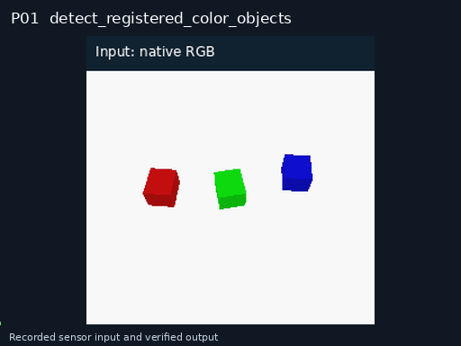</a> 
<strong>P01 · Registered-color object detection</strong> 
Recorded input / output
 <code>detect_registered_color_objects</code>
</td>
<td width="33%" align="center" valign="top">
<a href="assets/skills/gifs/P02.gif">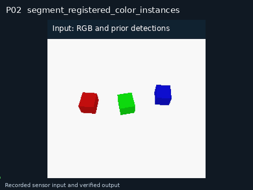</a> 
<strong>P02 · Registered-color instance segmentation</strong> 
Recorded input / output
 <code>segment_registered_color_instances</code>
</td>
<td width="33%" align="center" valign="top">
<a href="assets/skills/gifs/P03.gif">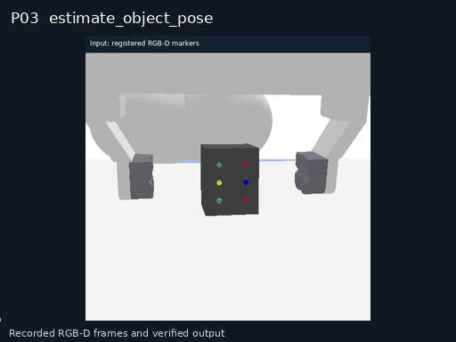</a> 
<strong>P03 · 6D object pose estimation</strong> 
Recorded input / output
 <code>estimate_object_pose</code>
</td>
</tr>
<tr>
<td width="33%" align="center" valign="top">
 
<strong>P04 · Calibrated depth-buffer decoding</strong> 
Recorded input / output
 <code>decode_calibrated_depth_buffer</code>
</td>
<td width="33%" align="center" valign="top">
<a href="assets/skills/gifs/P05.gif">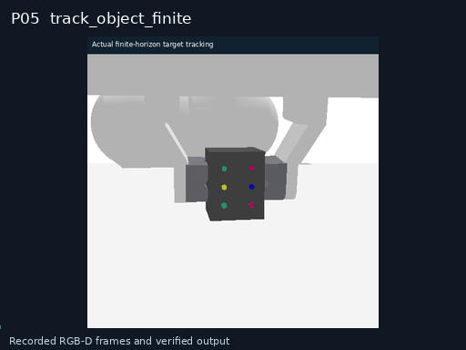</a> 
<strong>P05 · Finite-horizon object tracking</strong> 
Recorded input / output
 <code>track_object_finite</code>
</td>
<td width="33%" align="center" valign="top">
<a href="assets/skills/gifs/P06.gif">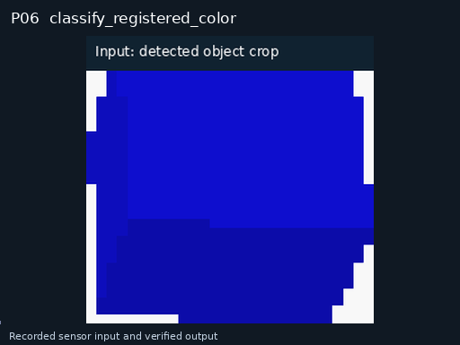</a> 
<strong>P06 · Registered-color classification</strong> 
Recorded input / output
 <code>classify_registered_color</code>
</td>
</tr>
<tr>
<td width="33%" align="center" valign="top">
<a href="assets/skills/gifs/P07.gif">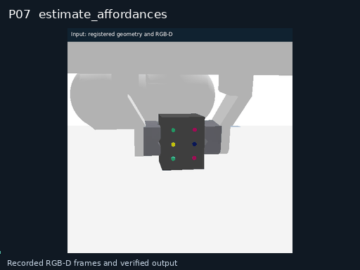</a> 
<strong>P07 · Affordance estimation</strong> 
Recorded input / output
 <code>estimate_affordances</code>
</td>
<td width="33%" align="center" valign="top">
<a href="assets/skills/gifs/P08.gif">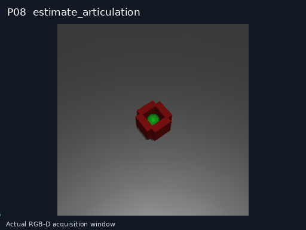</a> 
<strong>P08 · Articulation estimation</strong> 
Recorded input / output
 <code>estimate_articulation</code>
</td>
<td width="33%" align="center" valign="top">
<a href="assets/skills/gifs/P09.gif">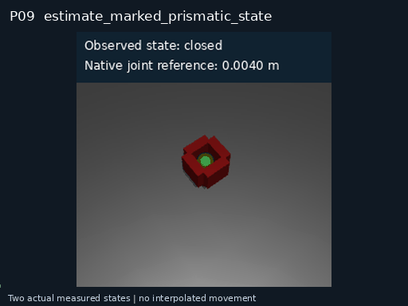</a> 
<strong>P09 · Marked prismatic-state estimation</strong> 
Recorded input / output
 <code>estimate_marked_prismatic_state</code>
</td>
</tr>
<tr>
<td width="33%" align="center" valign="top">
<a href="assets/skills/gifs/P10.gif">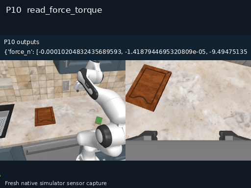</a> 
<strong>P10 · Force and torque sensing</strong> 
Recorded input / output
 <code>read_force_torque</code>
</td>
<td width="33%" align="center" valign="top">
<a href="assets/skills/gifs/P11.gif">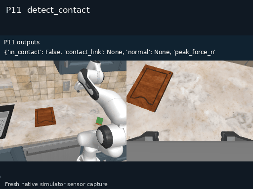</a> 
<strong>P11 · Contact detection</strong> 
Recorded input / output
 <code>detect_contact</code>
</td>
<td width="33%" align="center" valign="top">
<a href="assets/skills/gifs/P12.gif">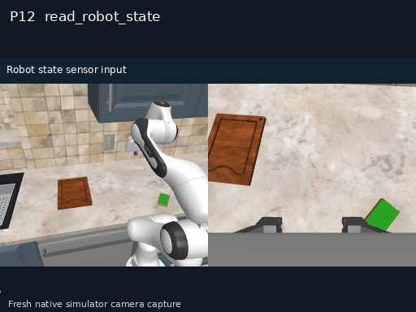</a> 
<strong>P12 · Robot-state sensing</strong> 
Simulator capture
 <code>read_robot_state</code>
</td>
</tr>
</table>

## M · Motion control · 11

<table>
<tr>
<td width="33%" align="center" valign="top">
<a href="assets/skills/gifs/M01.gif">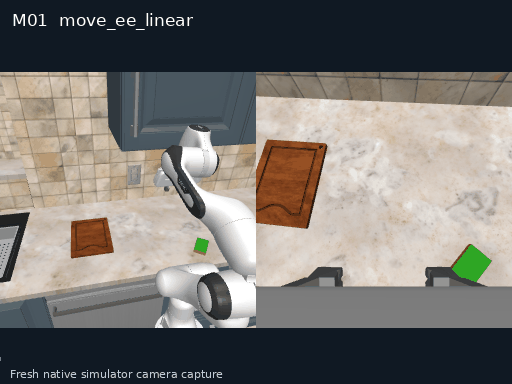</a> 
<strong>M01 · Linear end-effector motion</strong> 
Simulator capture
 <code>move_ee_linear</code>
</td>
<td width="33%" align="center" valign="top">
<a href="assets/skills/gifs/M02.gif">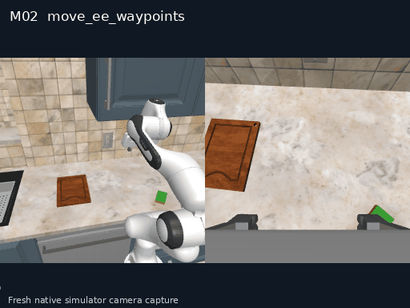</a> 
<strong>M02 · End-effector waypoint motion</strong> 
Simulator capture
 <code>move_ee_waypoints</code>
</td>
<td width="33%" align="center" valign="top">
<a href="assets/skills/gifs/M03.gif">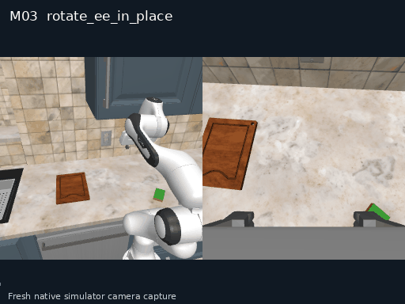</a> 
<strong>M03 · In-place end-effector rotation</strong> 
Simulator capture
 <code>rotate_ee_in_place</code>
</td>
</tr>
<tr>
<td width="33%" align="center" valign="top">
<a href="assets/skills/gifs/M04.gif">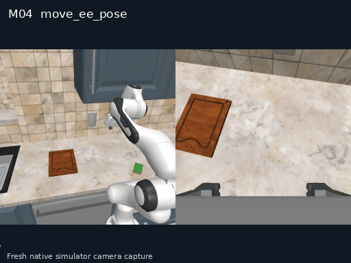</a> 
<strong>M04 · End-effector pose motion</strong> 
Simulator capture
 <code>move_ee_pose</code>
</td>
<td width="33%" align="center" valign="top">
<a href="assets/skills/gifs/M05.gif">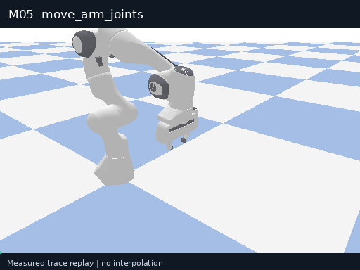</a> 
<strong>M05 · Arm joint motion</strong> 
Measured trace replay
 <code>move_arm_joints</code>
</td>
<td width="33%" align="center" valign="top">
<a href="assets/skills/gifs/M06.gif">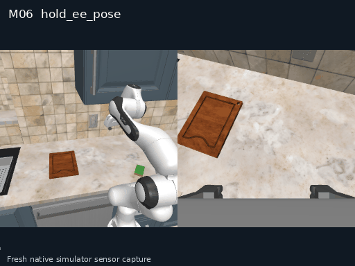</a> 
<strong>M06 · Timed end-effector pose hold</strong> 
Recorded input / output
 <code>hold_ee_pose</code>
</td>
</tr>
<tr>
<td width="33%" align="center" valign="top">
<a href="assets/skills/gifs/M08.gif">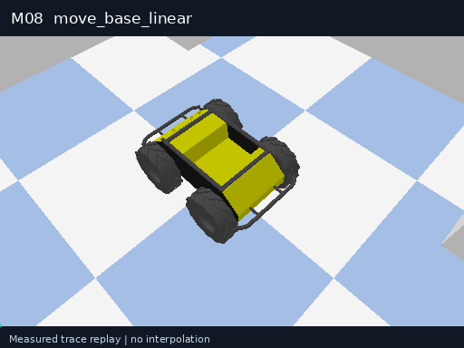</a> 
<strong>M08 · Straight base motion</strong> 
Measured trace replay
 <code>move_base_linear</code>
</td>
<td width="33%" align="center" valign="top">
<a href="assets/skills/gifs/M09.gif">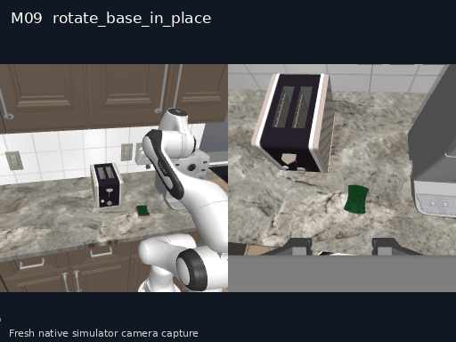</a> 
<strong>M09 · In-place base rotation</strong> 
Simulator capture
 <code>rotate_base_in_place</code>
</td>
<td width="33%" align="center" valign="top">
<a href="assets/skills/gifs/M10.gif">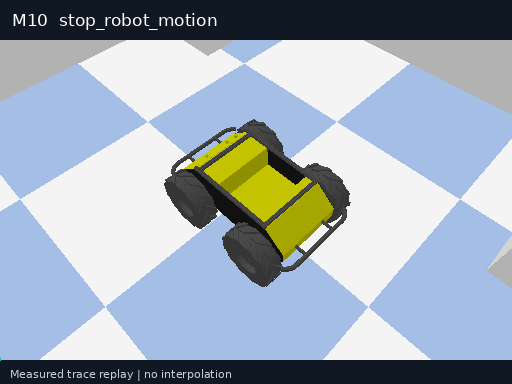</a> 
<strong>M10 · Controlled robot stop</strong> 
Measured trace replay
 <code>stop_robot_motion</code>
</td>
</tr>
<tr>
<td width="33%" align="center" valign="top">
<a href="assets/skills/gifs/M11.gif">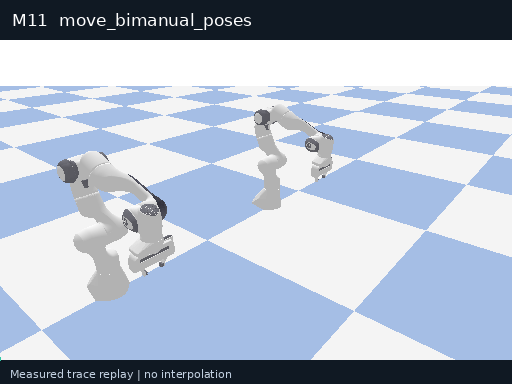</a> 
<strong>M11 · Synchronized dual-arm motion</strong> 
Measured trace replay
 <code>move_bimanual_poses</code>
</td>
<td width="33%" align="center" valign="top">
<a href="assets/skills/gifs/M12.gif">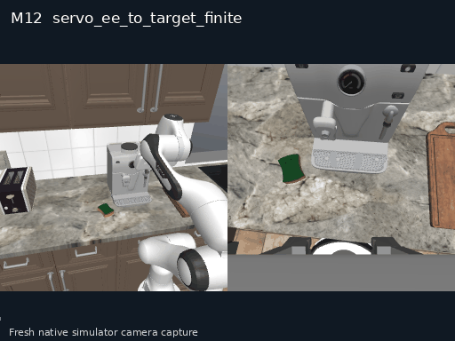</a> 
<strong>M12 · Finite-horizon visual servoing</strong> 
Simulator capture
 <code>servo_ee_to_target_finite</code>
</td>
</tr>
</table>

## G · Grasping and grippers · 8

<table>
<tr>
<td width="33%" align="center" valign="top">
<a href="assets/skills/gifs/G01.gif">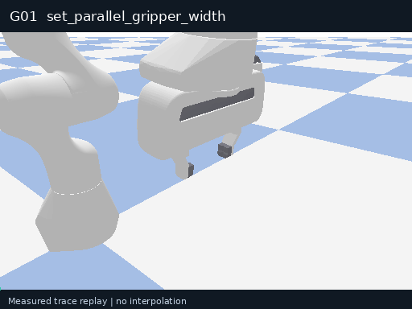</a> 
<strong>G01 · Parallel-gripper width control</strong> 
Measured trace replay
 <code>set_parallel_gripper_width</code>
</td>
<td width="33%" align="center" valign="top">
<a href="assets/skills/gifs/G03.gif">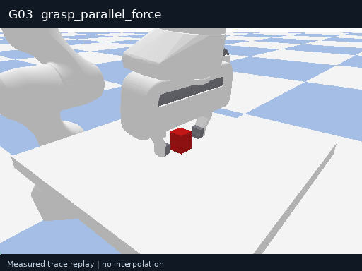</a> 
<strong>G03 · Force-controlled parallel grasp</strong> 
Measured trace replay
 <code>grasp_parallel_force</code>
</td>
<td width="33%" align="center" valign="top">
<a href="assets/skills/gifs/G04.gif">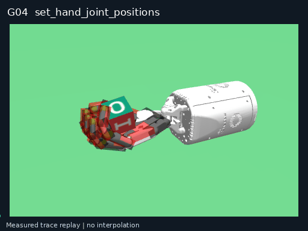</a> 
<strong>G04 · Dexterous-hand joint positioning</strong> 
Measured trace replay
 <code>set_hand_joint_positions</code>
</td>
</tr>
<tr>
<td width="33%" align="center" valign="top">
<a href="assets/skills/gifs/G05.gif">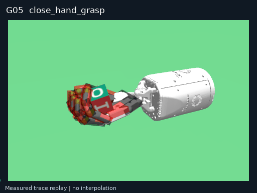</a> 
<strong>G05 · Parameterized dexterous grasp</strong> 
Measured trace replay
 <code>close_hand_grasp</code>
</td>
<td width="33%" align="center" valign="top">
<a href="assets/skills/gifs/G09.gif">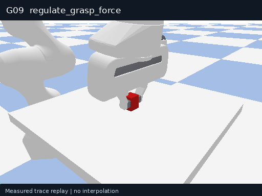</a> 
<strong>G09 · Timed grasp-force regulation</strong> 
Measured trace replay
 <code>regulate_grasp_force</code>
</td>
<td width="33%" align="center" valign="top">
<a href="assets/skills/gifs/G10.gif">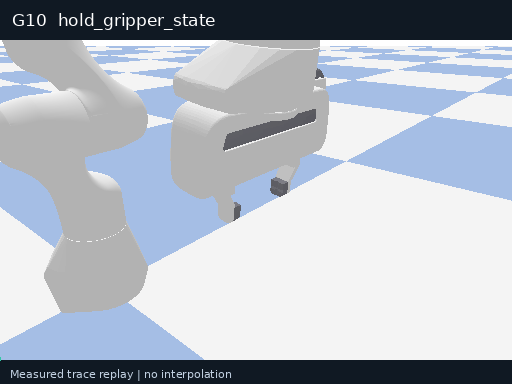</a> 
<strong>G10 · Timed gripper-state hold</strong> 
Measured trace replay
 <code>hold_gripper_state</code>
</td>
</tr>
<tr>
<td width="33%" align="center" valign="top">
<a href="assets/skills/gifs/G11.gif">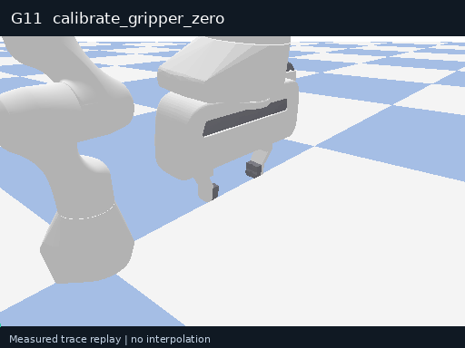</a> 
<strong>G11 · Gripper zero calibration</strong> 
Measured trace replay
 <code>calibrate_gripper_zero</code>
</td>
<td width="33%" align="center" valign="top">
 
<strong>G12 · Gripper step-response test</strong> 
Measured trace replay
 <code>step_gripper_response</code>
</td>
</tr>
</table>

## I · Object interaction · 9

<table>
<tr>
<td width="33%" align="center" valign="top">
<a href="assets/skills/gifs/I01.gif">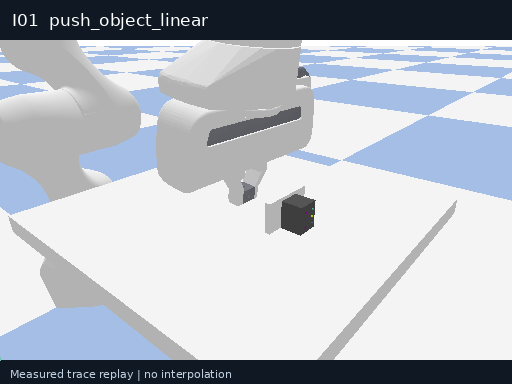</a> 
<strong>I01 · Linear object pushing</strong> 
Measured trace replay
 <code>push_object_linear</code>
</td>
<td width="33%" align="center" valign="top">
<a href="assets/skills/gifs/I02.gif">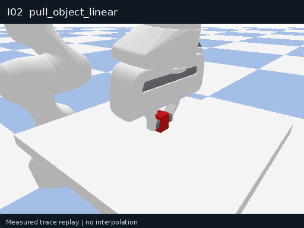</a> 
<strong>I02 · Linear object pulling</strong> 
Measured trace replay
 <code>pull_object_linear</code>
</td>
<td width="33%" align="center" valign="top">
 
<strong>I04 · Planar object rotation</strong> 
Measured trace replay
 <code>rotate_object_planar</code>
</td>
</tr>
<tr>
<td width="33%" align="center" valign="top">
<a href="assets/skills/gifs/I06.gif">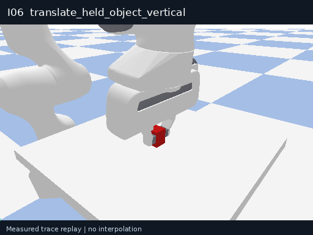</a> 
<strong>I06 · Vertical held-object motion</strong> 
Measured trace replay
 <code>translate_held_object_vertical</code>
</td>
<td width="33%" align="center" valign="top">
<a href="assets/skills/gifs/I08.gif">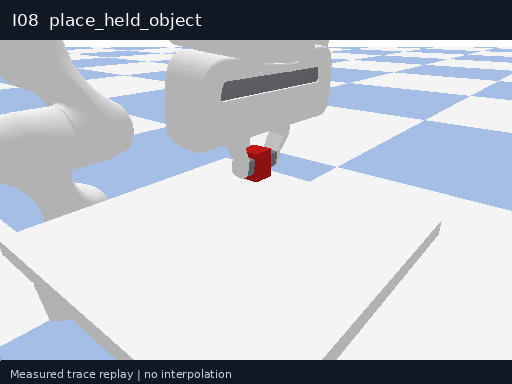</a> 
<strong>I08 · Held-object placement</strong> 
Measured trace replay
 <code>place_held_object</code>
</td>
<td width="33%" align="center" valign="top">
<a href="assets/skills/gifs/I09.gif">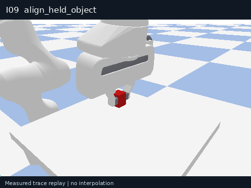</a> 
<strong>I09 · Held-object alignment</strong> 
Measured trace replay
 <code>align_held_object</code>
</td>
</tr>
<tr>
<td width="33%" align="center" valign="top">
<a href="assets/skills/gifs/I10.gif">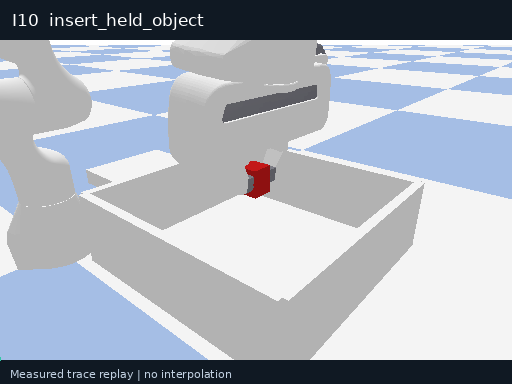</a> 
<strong>I10 · Straight held-object insertion</strong> 
Measured trace replay
 <code>insert_held_object</code>
</td>
<td width="33%" align="center" valign="top">
<a href="assets/skills/gifs/I11.gif">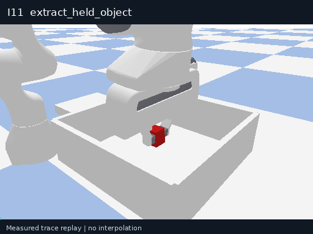</a> 
<strong>I11 · Straight held-object extraction</strong> 
Measured trace replay
 <code>extract_held_object</code>
</td>
<td width="33%" align="center" valign="top">
<a href="assets/skills/gifs/I12.gif">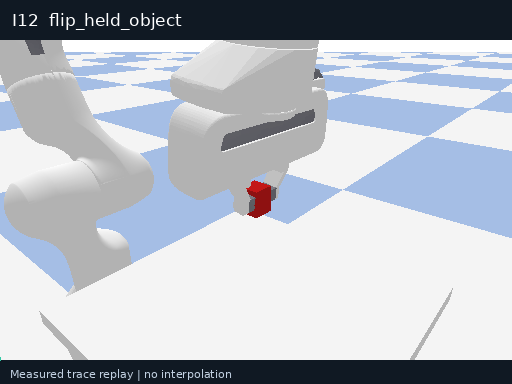</a> 
<strong>I12 · Held-object flipping</strong> 
Measured trace replay
 <code>flip_held_object</code>
</td>
</tr>
</table>

## A · Articulated objects · 6

<table>
<tr>
<td width="33%" align="center" valign="top">
<a href="assets/skills/gifs/A01.gif">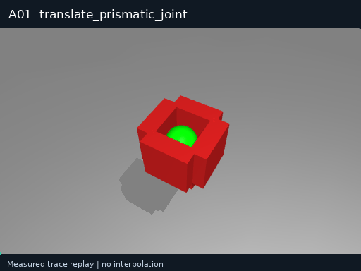</a> 
<strong>A01 · Prismatic-joint motion</strong> 
Measured trace replay
 <code>translate_prismatic_joint</code>
</td>
<td width="33%" align="center" valign="top">
<a href="assets/skills/gifs/A02.gif">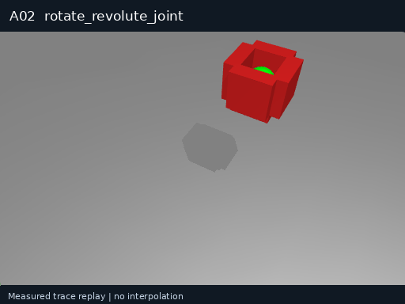</a> 
<strong>A02 · Revolute-joint motion</strong> 
Measured trace replay
 <code>rotate_revolute_joint</code>
</td>
<td width="33%" align="center" valign="top">
<a href="assets/skills/gifs/A03.gif">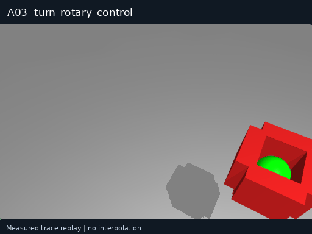</a> 
<strong>A03 · Rotary-control operation</strong> 
Measured trace replay
 <code>turn_rotary_control</code>
</td>
</tr>
<tr>
<td width="33%" align="center" valign="top">
<a href="assets/skills/gifs/A04.gif">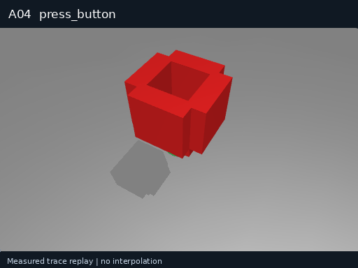</a> 
<strong>A04 · Button pressing</strong> 
Measured trace replay
 <code>press_button</code>
</td>
<td width="33%" align="center" valign="top">
<a href="assets/skills/gifs/A05.gif">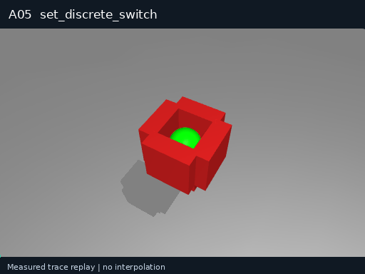</a> 
<strong>A05 · Discrete-switch positioning</strong> 
Measured trace replay
 <code>set_discrete_switch</code>
</td>
<td width="33%" align="center" valign="top">
<a href="assets/skills/gifs/A07.gif">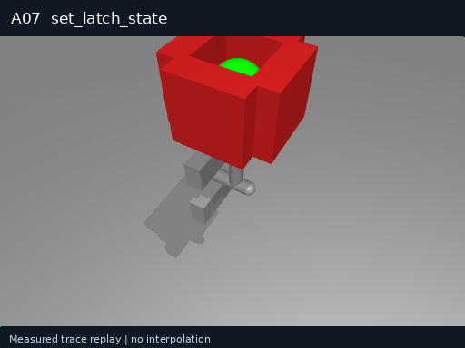</a> 
<strong>A07 · Mechanical latch operation</strong> 
Measured trace replay
 <code>set_latch_state</code>
</td>
</tr>
</table>

## T · Tool use · 2

<table>
<tr>
<td width="33%" align="center" valign="top">
<a href="assets/skills/gifs/T04.gif">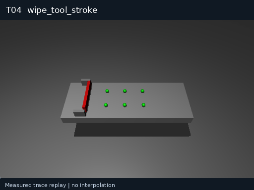</a> 
<strong>T04 · Single tool-wiping stroke</strong> 
Measured trace replay
 <code>wipe_tool_stroke</code>
</td>
<td width="33%" align="center" valign="top">
<a href="assets/skills/gifs/T08.gif">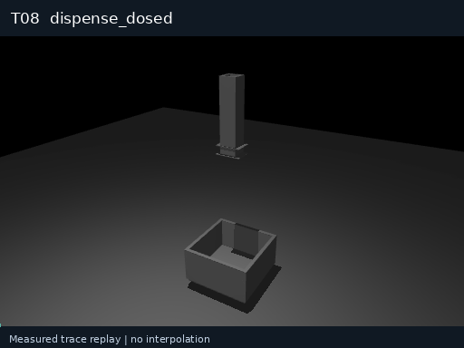</a> 
<strong>T08 · Dosed dispensing</strong> 
Measured trace replay
 <code>dispense_dosed</code>
</td>
</tr>
</table>

## N · Navigation · 6

<table>
<tr>
<td width="33%" align="center" valign="top">
<a href="assets/skills/gifs/N01.gif">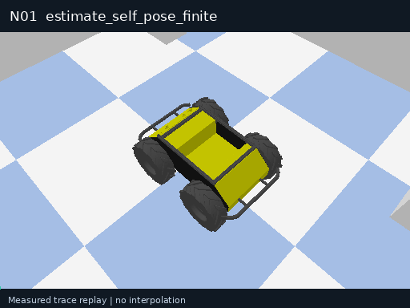</a> 
<strong>N01 · Finite-window self-localization</strong> 
Measured trace replay
 <code>estimate_self_pose_finite</code>
</td>
<td width="33%" align="center" valign="top">
<a href="assets/skills/gifs/N02.gif">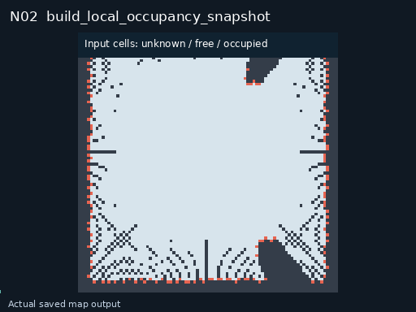</a> 
<strong>N02 · Local occupancy snapshot</strong> 
Recorded input / output
 <code>build_local_occupancy_snapshot</code>
</td>
<td width="33%" align="center" valign="top">
<a href="assets/skills/gifs/N03.gif">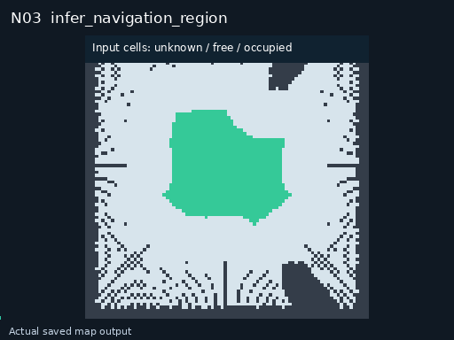</a> 
<strong>N03 · Traversable-region estimation</strong> 
Recorded input / output
 <code>infer_navigation_region</code>
</td>
</tr>
<tr>
<td width="33%" align="center" valign="top">
<a href="assets/skills/gifs/N04.gif">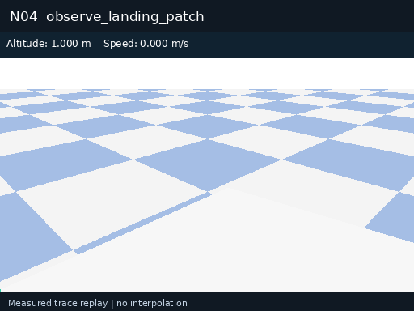</a> 
<strong>N04 · Landing-patch observation</strong> 
Measured trace replay
 <code>observe_landing_patch</code>
</td>
<td width="33%" align="center" valign="top">
<a href="assets/skills/gifs/N05.gif">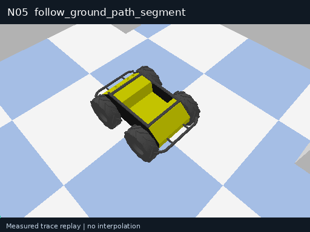</a> 
<strong>N05 · Ground-path segment following</strong> 
Measured trace replay
 <code>follow_ground_path_segment</code>
</td>
<td width="33%" align="center" valign="top">
 
<strong>N06 · Base docking alignment</strong> 
Measured trace replay
 <code>align_base_to_dock</code>
</td>
</tr>
</table>

## F · Flight control · 8

<table>
<tr>
<td width="33%" align="center" valign="top">
 
<strong>F01 · Constrained vertical takeoff</strong> 
Measured trace replay
 <code>takeoff_vertical</code>
</td>
<td width="33%" align="center" valign="top">
 
<strong>F02 · Constrained vertical landing</strong> 
Measured trace replay
 <code>land_vertical</code>
</td>
<td width="33%" align="center" valign="top">
 
<strong>F03 · Finite-duration hover</strong> 
Measured trace replay
 <code>hover_finite</code>
</td>
</tr>
<tr>
<td width="33%" align="center" valign="top">
 
<strong>F04 · Local-waypoint flight</strong> 
Measured trace replay
 <code>fly_to_local_waypoint</code>
</td>
<td width="33%" align="center" valign="top">
 
<strong>F05 · 3D trajectory-segment following</strong> 
Measured trace replay
 <code>follow_air_trajectory_segment</code>
</td>
<td width="33%" align="center" valign="top">
 
<strong>F06 · In-place aerial yaw</strong> 
Measured trace replay
 <code>rotate_air_yaw_in_place</code>
</td>
</tr>
<tr>
<td width="33%" align="center" valign="top">
 
<strong>F07 · Terrain-following flight</strong> 
Measured trace replay
 <code>follow_terrain_segment</code>
</td>
<td width="33%" align="center" valign="top">
 
<strong>F08 · Controlled aerial braking</strong> 
Measured trace replay
 <code>brake_aircraft_to_hold</code>
</td>
</tr>
</table>

## U · Gimbals and payloads · 2

<table>
<tr>
<td width="33%" align="center" valign="top">
 
<strong>U01 · Gimbal orientation control</strong> 
Measured trace replay
 <code>set_gimbal_orientation</code>
</td>
<td width="33%" align="center" valign="top">
 
<strong>U02 · Pose-tagged image capture</strong> 
Measured trace replay
 <code>capture_geotagged_frame</code>
</td>
</tr>
</table>

## Shared call contract

A skill defines inputs, preconditions, required capabilities, an execution budget, stopping criteria and failure feedback. The planner selects the skill and parameters, the backend generates actions, the environment executes them, and the verifier checks the goal state.

| Prefix | Domain | Count |
| --- | --- | --- |
| P | Perception | 12 |
| M | Motion | 11 |
| G | Grasping and grippers | 8 |
| I | Object interaction | 9 |
| A | Articulated objects | 6 |
| T | Tool use | 2 |
| N | Navigation | 6 |
| F | Flight | 8 |
| U | Gimbals and payloads | 2 |

The engineering list uses G11 for gripper zero calibration and G12 for response self-test. The packaged v2.2 execution catalog retains G07/G08 suction interfaces. These are different operations, so executable IDs must come from the selected catalog version.

## From atomic calls to compositions

A composition binds one step’s outputs to the next step’s inputs while preserving object identity, coordinate frames and state preconditions in a continuous world. Evaluated examples include grasp, lift, align and place; gimbal adjustment followed by pose-tagged capture; and path following followed by a controlled stop. Composition pass rates count complete program executions, separately from independent atomic-call trials.

Complete engineering skill index

## Engineering skill list

| ID | Engineering name | 中文名称 |
| --- | --- | --- |
| P01 | Detect objects | 目标检测 |
| P02 | Segment instances | 物体分割 |
| P03 | Estimate object pose | 物体位姿识别 |
| P04 | Estimate depth | 场景深度感知 |
| P05 | Track object finite | 阶段性目标跟踪 |
| P06 | Classify object attributes | 物体属性识别 |
| P07 | Estimate affordances | 可操作性分析 |
| P08 | Estimate articulation | 物体关节识别 |
| P09 | Estimate object state | 物体状态识别 |
| P10 | Read force torque | 力觉数据读取 |
| P11 | Detect contact | 接触检测 |
| P12 | Read robot state | 机器人状态读取 |
| M01 | Move ee linear | 末端定距直线移动 |
| M02 | Move ee waypoints | 末端多点路径移动 |
| M03 | Rotate ee in place | 末端旋转 |
| M04 | Move ee pose | 末端移动 |
| M05 | Move arm joints | 机械臂关节调节 |
| M06 | Hold ee pose | 末端定时静止 |
| M08 | Move base linear | 底盘直线移动 |
| M09 | Rotate base in place | 底盘原地旋转 |
| M10 | Stop robot motion | 机器人减速停止 |
| M11 | Move bimanual poses | 双臂同步移动 |
| M12 | Servo ee to target finite | 视觉闭环微调 |
| G01 | Set parallel gripper width | 夹爪开合度调节 |
| G03 | Grasp parallel force | 夹爪力控抓取 |
| G04 | Set hand joint positions | 灵巧手关节控制 |
| G05 | Close hand grasp | 灵巧手模式化抓握 |
| G09 | Regulate grasp force | 抓取力保持与调节 |
| G10 | Hold gripper state | 末端工具定时保持 |
| G11 | Gripper zero calibration | 夹爪零点标定 |
| G12 | Gripper step-response self-test | 夹爪响应性能自检 |
| I01 | Push object linear | 物体直线推动 |
| I02 | Pull object linear | 物体直线拉动 |
| I04 | Rotate object planar | 物体平面旋拧 |
| I06 | Translate held object vertical | 抓取物垂直升降 |
| I08 | Place held object | 抓取物放置落位 |
| I09 | Align held object | 抓取物姿态对准 |
| I10 | Insert held object | 抓取物直线插装 |
| I11 | Extract held object | 抓取物直线拔出 |
| I12 | Flip held object | 抓取物空间翻转 |
| A01 | Translate prismatic joint | 滑动机构推拉 |
| A02 | Rotate revolute joint | 铰链机构开合 |
| A03 | Turn rotary control | 旋钮与阀门旋转 |
| A04 | Press button | 按钮按压操作 |
| A05 | Set discrete switch | 多挡位开关调节 |
| A07 | Set latch state | 机械锁扣开合 |
| T04 | Wipe tool stroke | 工具单次擦拭 |
| T08 | Dispense dosed | 工具定量加注 |
| N01 | Estimate self pose finite | 机器人局部定位 |
| N02 | Build local occupancy snapshot | 局部障碍物建图 |
| N03 | Infer navigation region | 地面与低空可通行区检测 |
| N04 | Observe landing patch | 备选降落区地形评估 |
| N05 | Follow ground path segment | 局部路径跟踪行驶 |
| N06 | Align base to dock | 底盘对接对准 |
| F01 | Takeoff vertical | 受控垂直起飞 |
| F02 | Land vertical | 定点精准降落 |
| F03 | Hover finite | 定点定时悬停 |
| F04 | Fly to local waypoint | 单航点直线飞行 |
| F05 | Follow air trajectory segment | 空中局部轨迹跟踪 |
| F06 | Rotate air yaw in place | 悬停机头转向 |
| F07 | Follow terrain segment | 仿地定高飞行 |
| F08 | Brake aircraft to hold | 空中减速悬停 |
| U01 | Set gimbal orientation | 云台角度调节 |
| U02 | Capture geotagged frame | 带位姿图像采集 |

[Versioned execution catalog](../catalogs/v2.2/README.md) · [Demonstration console](https://liutong-luban-project.netlify.app/offline/)

