[English](atomic-skills.md) · [简体中文](atomic-skills.zh-CN.md)

# 原子技能与64项动图库

64项技能按9个功能域组织。每个动图下给出该演示版本的具体名称、调用标识和记录类型，点击图像可查看原尺寸。动图来源为2026-10-27的v2.4受控仿真演示，保留原始帧，没有补造或插值动作。

47项为执行技能，17项为感知技能，感知技能分布在P、N和U功能域。完整调用结果及后续v2.5三轮评测见[实验结果](reported-results.zh-CN.md#atomic-call-evaluation)。

[P 感知](#domain-p) · [M 运动控制](#domain-m) · [G 抓取与夹爪](#domain-g) · [I 物体交互](#domain-i) · [A 机构与开关](#domain-a) · [T 工具使用](#domain-t) · [N 导航与定位](#domain-n) · [F 飞行控制](#domain-f) · [U 云台与载荷](#domain-u)

[调用契约与组合方式](#call-contract)

演示版本、来源与输入条件

## 动图版本与输入条件

P01、P02和P06展示已知高饱和颜色目标的检测、分割及有限颜色识别，P04使用已知相机参数解码深度缓冲，P09展示带标记直线机构的状态估计。下方名称按这些实际演示能力填写。2026-10-28的v2.5评测使用恢复后的模型感知配置，其统计单独列示。其余动图也区分仿真相机实录、观测输出与实测轨迹回放，回放图像本身不作为通过率分母。

[动图来源、尺寸、帧数与文件摘要](assets/skills/gifs/manifest.json) · [独立评测包](https://github.com/yuliu-ai/atomic-skill-evaluator)

## P · 感知 · 12

<table>
<tr>
<td width="33%" align="center" valign="top">
<a href="assets/skills/gifs/P01.gif">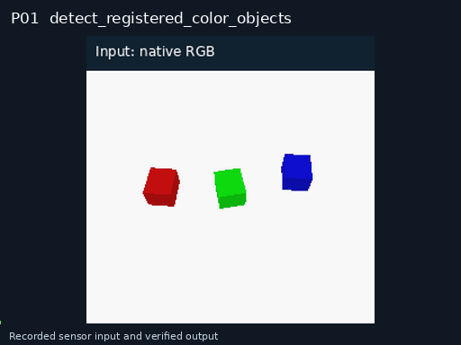</a> 
<strong>P01 · 已知颜色目标检测</strong> 
观测与输出记录
 <code>detect_registered_color_objects</code>

对单帧RGB中的red、green、blue连通区域生成对象候选，适用于分离的高饱和颜色标记。

</td>
<td width="33%" align="center" valign="top">
<a href="assets/skills/gifs/P02.gif">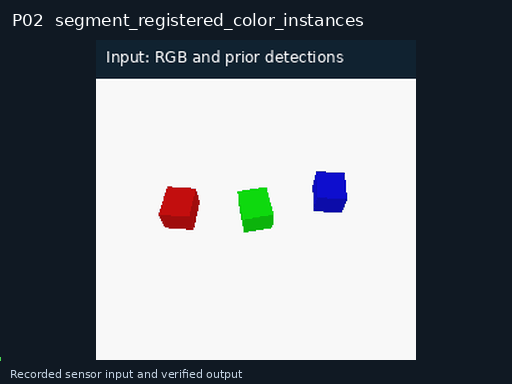</a> 
<strong>P02 · 已知颜色目标实例分割</strong> 
观测与输出记录
 <code>segment_registered_color_instances</code>

对给定检测框中的已知颜色标记生成PNG实例掩码，保持对象ID。

</td>
<td width="33%" align="center" valign="top">
<a href="assets/skills/gifs/P03.gif">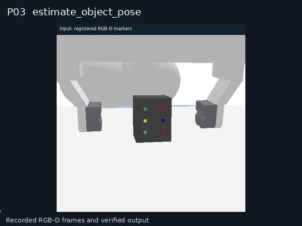</a> 
<strong>P03 · 物体六维位姿估计</strong> 
观测与输出记录
 <code>estimate_object_pose</code>

在指定坐标系估计单个对象的六维位姿和协方差。

</td>
</tr>
<tr>
<td width="33%" align="center" valign="top">
 
<strong>P04 · 标定深度图解码</strong> 
观测与输出记录
 <code>decode_calibrated_depth_buffer</code>

用已知near/far相机参数将非线性深度缓冲解码为米制深度图。

</td>
<td width="33%" align="center" valign="top">
<a href="assets/skills/gifs/P05.gif">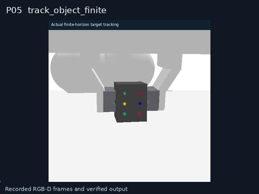</a> 
<strong>P05 · 有限时域目标跟踪</strong> 
观测与输出记录
 <code>track_object_finite</code>

在显式时间窗内跟踪一个目标并返回有限轨迹。

</td>
<td width="33%" align="center" valign="top">
<a href="assets/skills/gifs/P06.gif">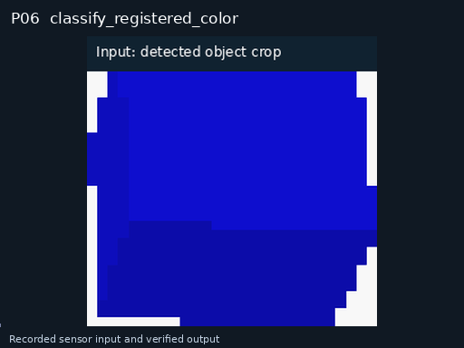</a> 
<strong>P06 · 有限颜色集合识别</strong> 
观测与输出记录
 <code>classify_registered_color</code>

对已定位目标裁剪识别red、green、blue三类颜色，仅处理color属性。

</td>
</tr>
<tr>
<td width="33%" align="center" valign="top">
<a href="assets/skills/gifs/P07.gif">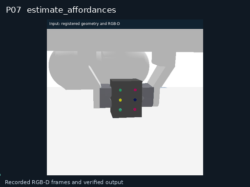</a> 
<strong>P07 · 可操作性估计</strong> 
观测与输出记录
 <code>estimate_affordances</code>

为单个对象输出候选操作类型及局部作用区域，不生成动作序列。

</td>
<td width="33%" align="center" valign="top">
<a href="assets/skills/gifs/P08.gif">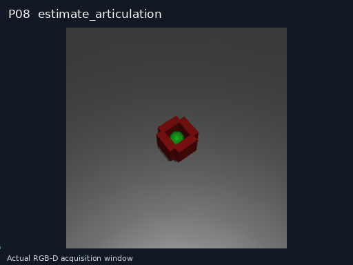</a> 
<strong>P08 · 可动关节估计</strong> 
观测与输出记录
 <code>estimate_articulation</code>

估计对象的单个可动关节类型、轴、范围和当前位置。

</td>
<td width="33%" align="center" valign="top">
<a href="assets/skills/gifs/P09.gif">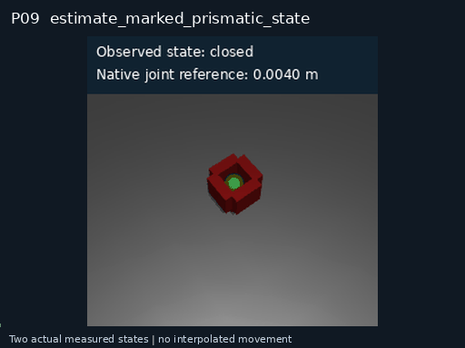</a> 
<strong>P09 · 标记直线机构状态估计</strong> 
观测与输出记录
 <code>estimate_marked_prismatic_state</code>

用标定RGB-D中已知半径绿色球标记拟合直线机构位置，以0.025m为开合状态分界。

</td>
</tr>
<tr>
<td width="33%" align="center" valign="top">
<a href="assets/skills/gifs/P10.gif">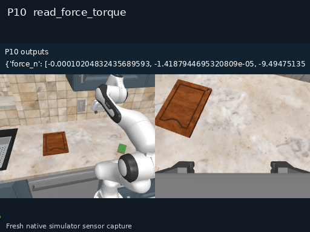</a> 
<strong>P10 · 力与力矩读取</strong> 
观测与输出记录
 <code>read_force_torque</code>

读取一个时刻的六轴力与力矩并变换到目标坐标系。

</td>
<td width="33%" align="center" valign="top">
<a href="assets/skills/gifs/P11.gif">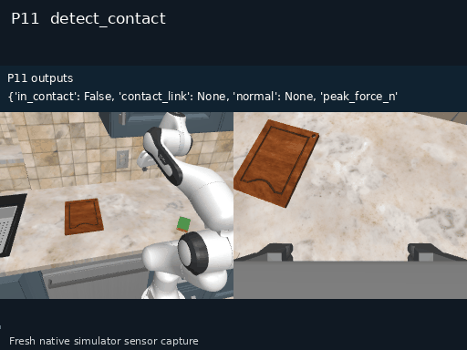</a> 
<strong>P11 · 接触检测</strong> 
观测与输出记录
 <code>detect_contact</code>

在有限传感窗口内判断是否接触并估计接触法向。

</td>
<td width="33%" align="center" valign="top">
<a href="assets/skills/gifs/P12.gif">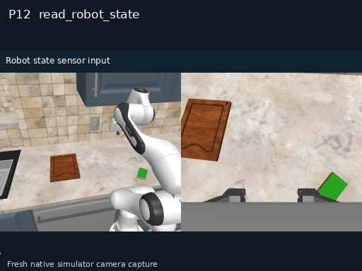</a> 
<strong>P12 · 机器人状态读取</strong> 
仿真相机实录
 <code>read_robot_state</code>

只读获取一个同步窗口内的机器人状态快照；按请求包含机械臂、底盘或无人机位姿、速度、飞行模式、电池、定位和链路状态。

</td>
</tr>
</table>

## M · 运动控制 · 11

<table>
<tr>
<td width="33%" align="center" valign="top">
<a href="assets/skills/gifs/M01.gif">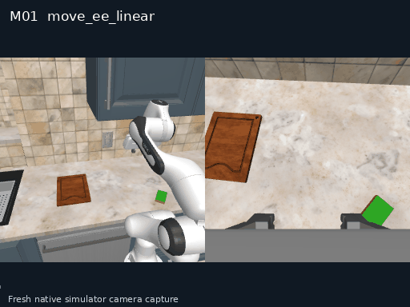</a> 
<strong>M01 · 末端参数化直线移动</strong> 
仿真相机实录
 <code>move_ee_linear</code>

以绝对目标或相对位移完成一次末端直线运动；撤离作为相对位移参数，不含恢复规划。

</td>
<td width="33%" align="center" valign="top">
<a href="assets/skills/gifs/M02.gif">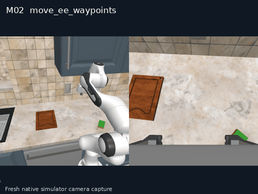</a> 
<strong>M02 · 末端有限航点路径移动</strong> 
仿真相机实录
 <code>move_ee_waypoints</code>

沿有限航点序列完成单次连续末端位姿转移。

</td>
<td width="33%" align="center" valign="top">
<a href="assets/skills/gifs/M03.gif">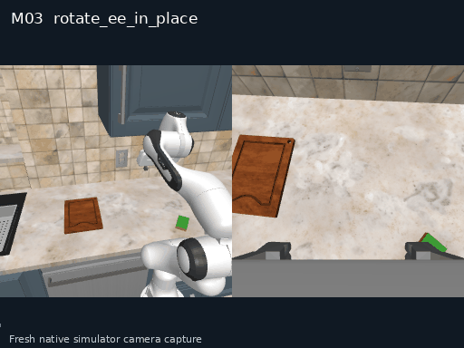</a> 
<strong>M03 · 末端原位旋转</strong> 
仿真相机实录
 <code>rotate_ee_in_place</code>

在位置保持容差内仅改变单个末端姿态。

</td>
</tr>
<tr>
<td width="33%" align="center" valign="top">
<a href="assets/skills/gifs/M04.gif">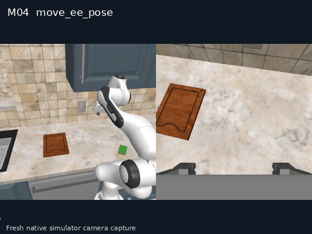</a> 
<strong>M04 · 末端位姿移动</strong> 
仿真相机实录
 <code>move_ee_pose</code>

把单个末端连续移动到一个目标SE3位姿。

</td>
<td width="33%" align="center" valign="top">
<a href="assets/skills/gifs/M05.gif">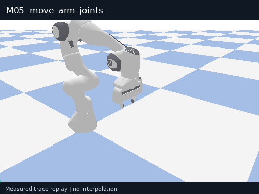</a> 
<strong>M05 · 机械臂关节移动</strong> 
实测轨迹回放
 <code>move_arm_joints</code>

把单臂关节向量移动到同维目标向量。

</td>
<td width="33%" align="center" valign="top">
<a href="assets/skills/gifs/M06.gif">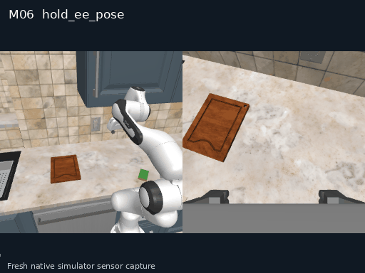</a> 
<strong>M06 · 末端定时保持</strong> 
观测与输出记录
 <code>hold_ee_pose</code>

在显式有限时长内保持末端位姿并抑制扰动。

</td>
</tr>
<tr>
<td width="33%" align="center" valign="top">
<a href="assets/skills/gifs/M08.gif">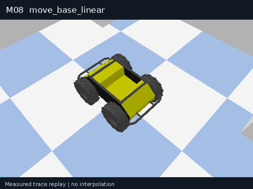</a> 
<strong>M08 · 移动底盘直线移动</strong> 
实测轨迹回放
 <code>move_base_linear</code>

在局部坐标系沿直线移动底盘有限距离。

</td>
<td width="33%" align="center" valign="top">
<a href="assets/skills/gifs/M09.gif">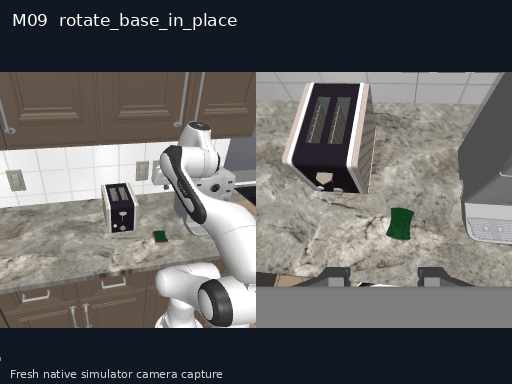</a> 
<strong>M09 · 移动底盘原地旋转</strong> 
仿真相机实录
 <code>rotate_base_in_place</code>

在平移漂移容差内让底盘原地旋转给定角度。

</td>
<td width="33%" align="center" valign="top">
<a href="assets/skills/gifs/M10.gif">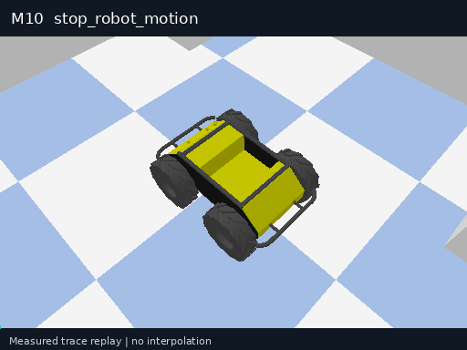</a> 
<strong>M10 · 机器人受控停止</strong> 
实测轨迹回放
 <code>stop_robot_motion</code>

对指定运动资源受控停止并验证速度降到阈值。

</td>
</tr>
<tr>
<td width="33%" align="center" valign="top">
<a href="assets/skills/gifs/M11.gif">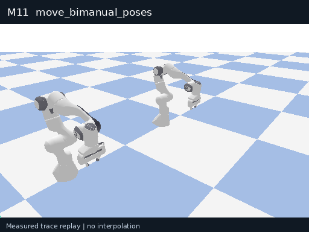</a> 
<strong>M11 · 双臂同步位姿移动</strong> 
实测轨迹回放
 <code>move_bimanual_poses</code>

把左右末端作为联合状态同步移动到目标位姿对。

</td>
<td width="33%" align="center" valign="top">
<a href="assets/skills/gifs/M12.gif">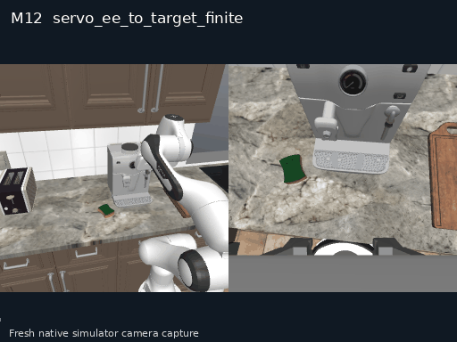</a> 
<strong>M12 · 有限时域视觉伺服</strong> 
仿真相机实录
 <code>servo_ee_to_target_finite</code>

在显式步数和时限内依据外部目标流调整末端位姿。

</td>
</tr>
</table>

## G · 抓取与夹爪 · 8

<table>
<tr>
<td width="33%" align="center" valign="top">
<a href="assets/skills/gifs/G01.gif">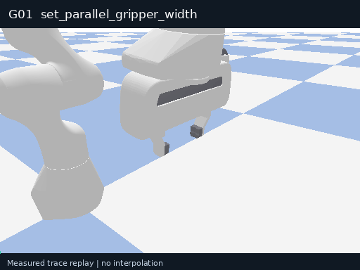</a> 
<strong>G01 · 平行夹爪定宽调节</strong> 
实测轨迹回放
 <code>set_parallel_gripper_width</code>

将夹爪调到一个目标开口；张开和定宽闭合用同一接口，不宣称抓取或释放已验证。

</td>
<td width="33%" align="center" valign="top">
<a href="assets/skills/gifs/G03.gif">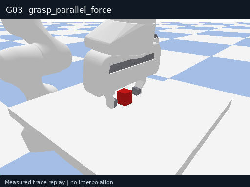</a> 
<strong>G03 · 平行夹爪力控抓取</strong> 
实测轨迹回放
 <code>grasp_parallel_force</code>

在夹爪已对准目标后闭合并建立可验证的力控抓取附着。

</td>
<td width="33%" align="center" valign="top">
<a href="assets/skills/gifs/G04.gif">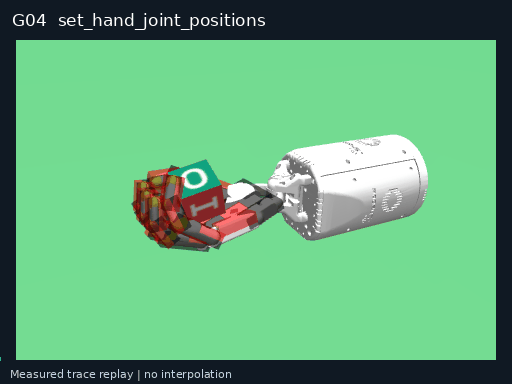</a> 
<strong>G04 · 灵巧手关节定位</strong> 
实测轨迹回放
 <code>set_hand_joint_positions</code>

把指定灵巧手关节定位到目标向量。

</td>
</tr>
<tr>
<td width="33%" align="center" valign="top">
<a href="assets/skills/gifs/G05.gif">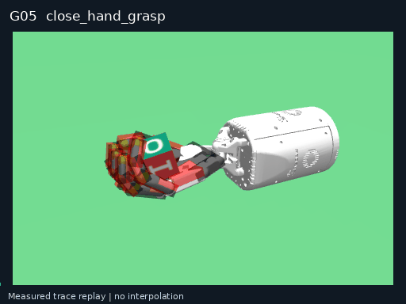</a> 
<strong>G05 · 灵巧手参数化抓取闭合</strong> 
实测轨迹回放
 <code>close_hand_grasp</code>

在指尖/手掌已对准对象后，以捏取或包络闭合模式建立一个经验证附着；不含机械臂接近。

</td>
<td width="33%" align="center" valign="top">
<a href="assets/skills/gifs/G09.gif">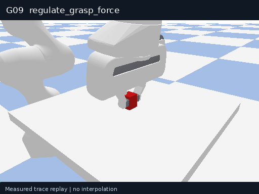</a> 
<strong>G09 · 定时抓取力调节</strong> 
实测轨迹回放
 <code>regulate_grasp_force</code>

在有限时域内把已有抓取附着的夹持力调节到新目标。

</td>
<td width="33%" align="center" valign="top">
<a href="assets/skills/gifs/G10.gif">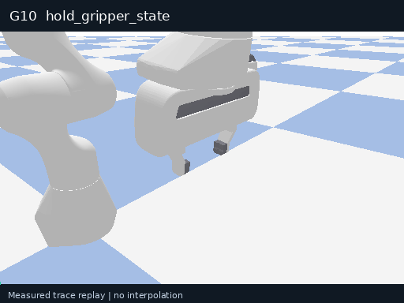</a> 
<strong>G10 · 末端执行器定时保持</strong> 
实测轨迹回放
 <code>hold_gripper_state</code>

在显式有限时长内保持夹爪、灵巧手或吸盘状态。

</td>
</tr>
<tr>
<td width="33%" align="center" valign="top">
<a href="assets/skills/gifs/G11.gif">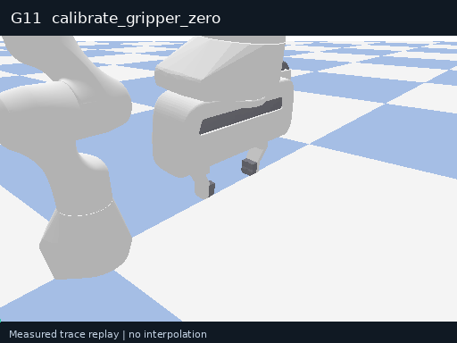</a> 
<strong>G11 · 平行夹爪零位标定</strong> 
实测轨迹回放
 <code>calibrate_gripper_zero</code>

空载下多轮完全闭合平行夹爪，测量零位残余宽度、轮间重复性与峰值闭合力；产出标定数据，不执行抓取。

</td>
<td width="33%" align="center" valign="top">
 
<strong>G12 · 夹爪阶跃响应自检</strong> 
实测轨迹回放
 <code>step_gripper_response</code>

空载下对平行夹爪下发一次阶跃开度指令，测量到位时间、稳态误差与峰值速度；用于执行前健康自检，不执行抓取。

</td>
</tr>
</table>

## I · 物体交互 · 9

<table>
<tr>
<td width="33%" align="center" valign="top">
<a href="assets/skills/gifs/I01.gif">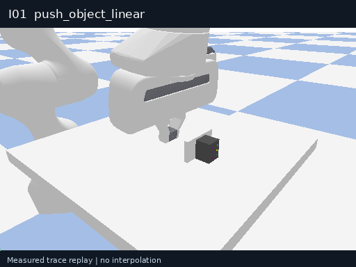</a> 
<strong>I01 · 物体直线推动</strong> 
实测轨迹回放
 <code>push_object_linear</code>

保持单点接触，沿指定直线推动对象有限距离。

</td>
<td width="33%" align="center" valign="top">
<a href="assets/skills/gifs/I02.gif">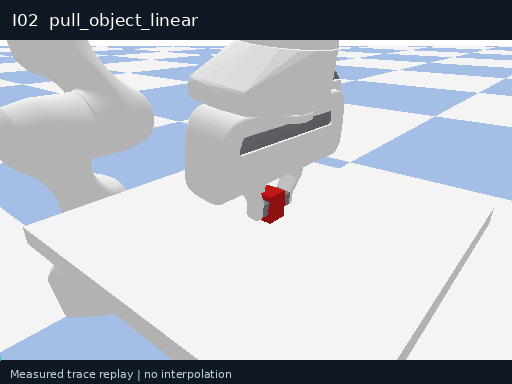</a> 
<strong>I02 · 物体直线拉动</strong> 
实测轨迹回放
 <code>pull_object_linear</code>

利用已有附着沿指定直线拉动对象有限距离。

</td>
<td width="33%" align="center" valign="top">
 
<strong>I04 · 物体平面旋转</strong> 
实测轨迹回放
 <code>rotate_object_planar</code>

在支撑平面内把对象绕给定枢轴旋转有限角度。

</td>
</tr>
<tr>
<td width="33%" align="center" valign="top">
<a href="assets/skills/gifs/I06.gif">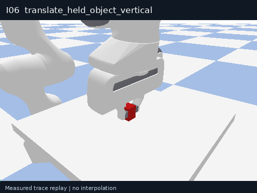</a> 
<strong>I06 · 被持物体竖直移动</strong> 
实测轨迹回放
 <code>translate_held_object_vertical</code>

保持已有抓取，沿重力或反重力方向移动一次；下降可显式请求以支撑接触终止。

</td>
<td width="33%" align="center" valign="top">
<a href="assets/skills/gifs/I08.gif">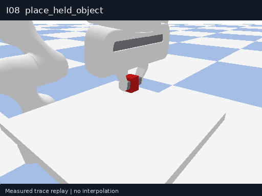</a> 
<strong>I08 · 被持物体落座</strong> 
实测轨迹回放
 <code>place_held_object</code>

让被持对象与目标支撑面建立稳定接触，但不解除抓取。

</td>
<td width="33%" align="center" valign="top">
<a href="assets/skills/gifs/I09.gif">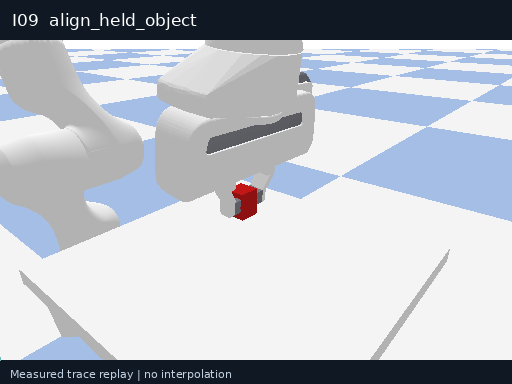</a> 
<strong>I09 · 被持物体位姿对准</strong> 
实测轨迹回放
 <code>align_held_object</code>

保持已有附着，把对象本体位姿对准单一目标位姿。

</td>
</tr>
<tr>
<td width="33%" align="center" valign="top">
<a href="assets/skills/gifs/I10.gif">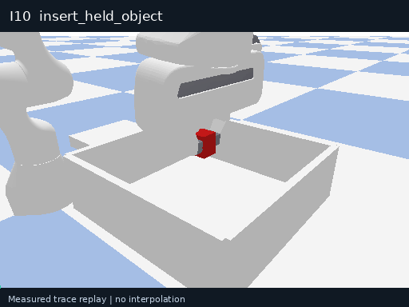</a> 
<strong>I10 · 被持物体直线插入</strong> 
实测轨迹回放
 <code>insert_held_object</code>

沿给定轴把已对准对象插入有限深度。

</td>
<td width="33%" align="center" valign="top">
<a href="assets/skills/gifs/I11.gif">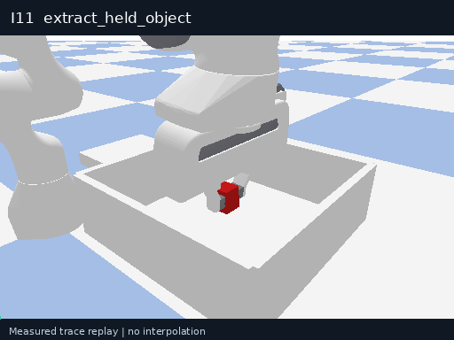</a> 
<strong>I11 · 被持物体直线拔出</strong> 
实测轨迹回放
 <code>extract_held_object</code>

沿给定轴把已附着对象从配合结构中拔出有限距离。

</td>
<td width="33%" align="center" valign="top">
<a href="assets/skills/gifs/I12.gif">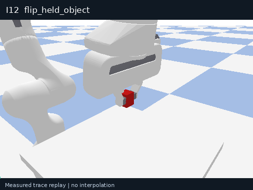</a> 
<strong>I12 · 被持物体翻转</strong> 
实测轨迹回放
 <code>flip_held_object</code>

保持已有附着，使对象绕指定本体轴旋转有限角度。

</td>
</tr>
</table>

## A · 机构与开关 · 6

<table>
<tr>
<td width="33%" align="center" valign="top">
<a href="assets/skills/gifs/A01.gif">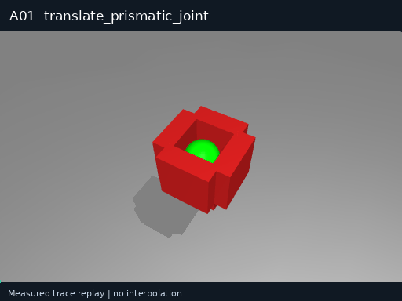</a> 
<strong>A01 · 移动直线关节对象</strong> 
实测轨迹回放
 <code>translate_prismatic_joint</code>

沿已知关节轴把抽屉等对象移动到目标关节位置。

</td>
<td width="33%" align="center" valign="top">
<a href="assets/skills/gifs/A02.gif">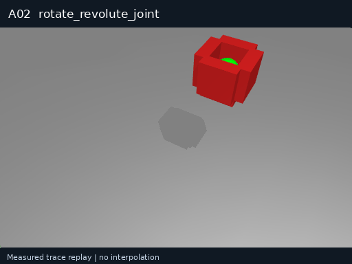</a> 
<strong>A02 · 转动旋转关节对象</strong> 
实测轨迹回放
 <code>rotate_revolute_joint</code>

绕已知关节轴把门或盖移动到目标角度。

</td>
<td width="33%" align="center" valign="top">
<a href="assets/skills/gifs/A03.gif">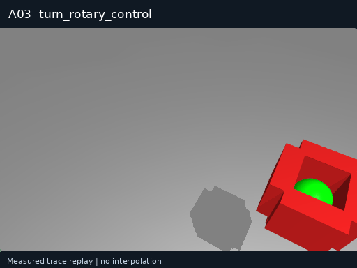</a> 
<strong>A03 · 旋转控制件</strong> 
实测轨迹回放
 <code>turn_rotary_control</code>

把旋钮或阀门转到目标标量值。

</td>
</tr>
<tr>
<td width="33%" align="center" valign="top">
<a href="assets/skills/gifs/A04.gif">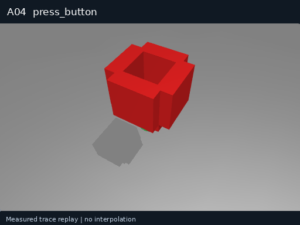</a> 
<strong>A04 · 按压按钮</strong> 
实测轨迹回放
 <code>press_button</code>

沿按钮法向按压一次到目标深度或触发状态。

</td>
<td width="33%" align="center" valign="top">
<a href="assets/skills/gifs/A05.gif">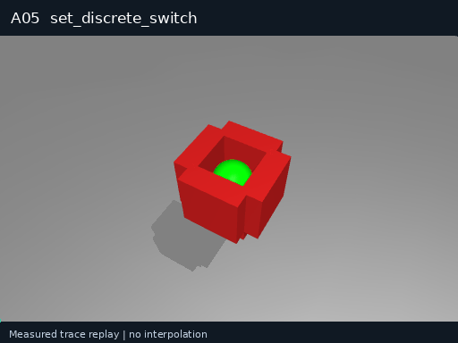</a> 
<strong>A05 · 离散开关挡位调节</strong> 
实测轨迹回放
 <code>set_discrete_switch</code>

沿已注册机构轨迹将拨杆或滑动开关调到一个目标挡位；机构类型显式声明。

</td>
<td width="33%" align="center" valign="top">
<a href="assets/skills/gifs/A07.gif">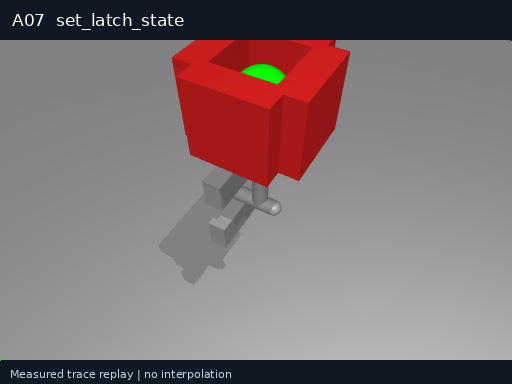</a> 
<strong>A07 · 机械卡扣状态调节</strong> 
实测轨迹回放
 <code>set_latch_state</code>

对已对准或已具备释放条件的卡扣执行一次受限动作，使其到达locked或released；不含前置对准或后续开门。

</td>
</tr>
</table>

## T · 工具使用 · 2

<table>
<tr>
<td width="33%" align="center" valign="top">
<a href="assets/skills/gifs/T04.gif">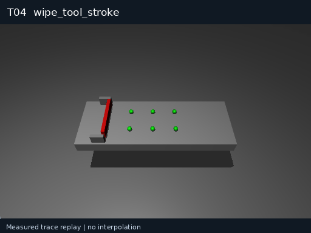</a> 
<strong>T04 · 工具单次擦拭行程</strong> 
实测轨迹回放
 <code>wipe_tool_stroke</code>

保持工具附着，沿一个有限平面轨迹完成单次擦拭。

</td>
<td width="33%" align="center" valign="top">
<a href="assets/skills/gifs/T08.gif">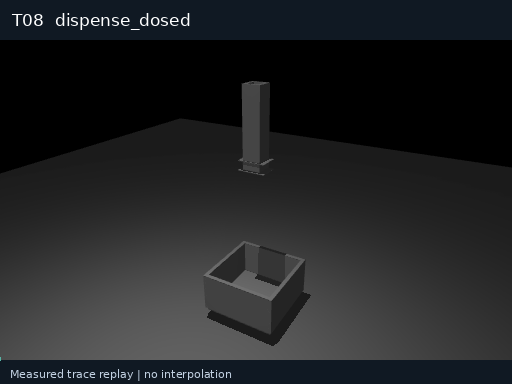</a> 
<strong>T08 · 执行器定量分配</strong> 
实测轨迹回放
 <code>dispense_dosed</code>

触发已对准分配器，输出一次指定量的介质。

</td>
</tr>
</table>

## N · 导航与定位 · 6

<table>
<tr>
<td width="33%" align="center" valign="top">
<a href="assets/skills/gifs/N01.gif">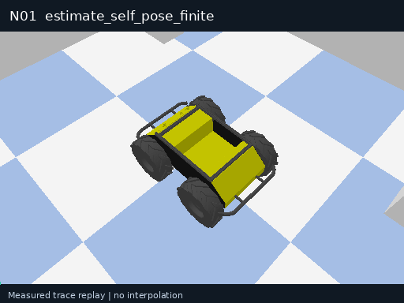</a> 
<strong>N01 · 有限窗口机器人自主定位</strong> 
实测轨迹回放
 <code>estimate_self_pose_finite</code>

从一个有限、同步观测窗口和已注册定位模型计算机器人自身位姿与不确定度；不移动机器人，不等同于遥测读取。

</td>
<td width="33%" align="center" valign="top">
<a href="assets/skills/gifs/N02.gif">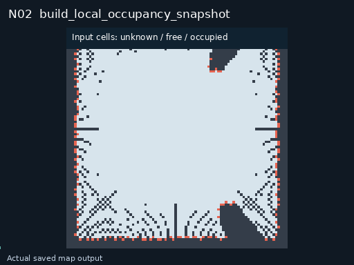</a> 
<strong>N02 · 局部占据空间快照生成</strong> 
观测与输出记录
 <code>build_local_occupancy_snapshot</code>

将有限传感窗口及配套位姿投影为一个有边界的二维栅格或三维体素占据快照；只返回不可变地图引用，不启动持续建图。

</td>
<td width="33%" align="center" valign="top">
<a href="assets/skills/gifs/N03.gif">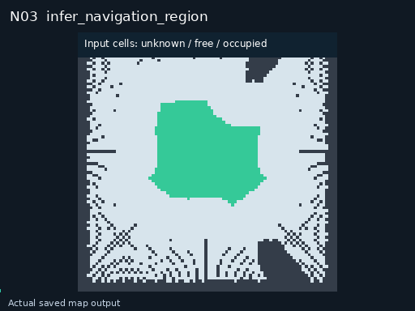</a> 
<strong>N03 · 地面可通行区与空中净空区估计</strong> 
观测与输出记录
 <code>infer_navigation_region</code>

对一个局部占据快照按机器人外形和运动域标注可通行区域或三维净空区域；返回区域观测，不选择路线。

</td>
</tr>
<tr>
<td width="33%" align="center" valign="top">
<a href="assets/skills/gifs/N04.gif">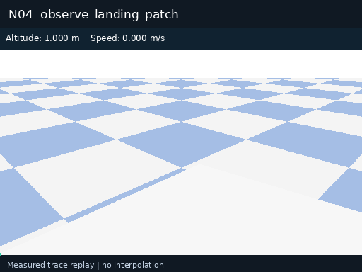</a> 
<strong>N04 · 候选着陆区几何观测</strong> 
实测轨迹回放
 <code>observe_landing_patch</code>

对上层已经指定的一个候选着陆区域估计坡度、粗糙度、净空和可用面积，给出适用性观测；不搜索多个备降点，不执行降落。

</td>
<td width="33%" align="center" valign="top">
<a href="assets/skills/gifs/N05.gif">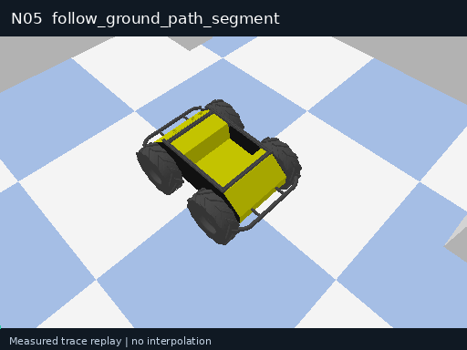</a> 
<strong>N05 · 地面有限路径段跟随</strong> 
实测轨迹回放
 <code>follow_ground_path_segment</code>

以底盘局部闭环控制执行一段已给定的有限二维路径并在末端停稳；可在批准走廊内修正跟踪误差，不执行全局路线搜索。

</td>
<td width="33%" align="center" valign="top">
 
<strong>N06 · 底盘局部对接位姿对准</strong> 
实测轨迹回放
 <code>align_base_to_dock</code>

在已到达对接区域且目标位姿已知时，进行一次有界底盘精定位，使其到达对接前的目标相对位姿；不包含寻站、长途返回、锁合或充电。

</td>
</tr>
</table>

## F · 飞行控制 · 8

<table>
<tr>
<td width="33%" align="center" valign="top">
 
<strong>F01 · 多旋翼受限垂直起飞</strong> 
实测轨迹回放
 <code>takeoff_vertical</code>

在已解锁且起飞检查通过的条件下，沿起飞点竖直方向上升到指定相对高度并停稳，不包含解锁或后续航线任务。

</td>
<td width="33%" align="center" valign="top">
 
<strong>F02 · 指定区域受限垂直降落</strong> 
实测轨迹回放
 <code>land_vertical</code>

从已处于指定着陆区上方的受控飞行状态下降并完成着陆确认；不负责返航、搜索备降点或降落后的断电任务。

</td>
<td width="33%" align="center" valign="top">
 
<strong>F03 · 有限时域位置悬停</strong> 
实测轨迹回放
 <code>hover_finite</code>

在已处于目标邻域的空中状态，按给定有限时间保持位置与偏航；结束时移交保持控制器，不把无限等待计为技能。

</td>
</tr>
<tr>
<td width="33%" align="center" valign="top">
 
<strong>F04 · 单一局部航点飞行</strong> 
实测轨迹回放
 <code>fly_to_local_waypoint</code>

在批准的三维通行走廊中完成一个局部目标点的位置与偏航转移并停稳；不生成或切换全局航线。

</td>
<td width="33%" align="center" valign="top">
 
<strong>F05 · 三维有限轨迹段跟随</strong> 
实测轨迹回放
 <code>follow_air_trajectory_segment</code>

按给定带时间标记的位置、速度和偏航样本执行一段连续三维轨迹；轨迹不含任务回调、起降阶段切换或全局重规划。

</td>
<td width="33%" align="center" valign="top">
 
<strong>F06 · 空中定点偏航调整</strong> 
实测轨迹回放
 <code>rotate_air_yaw_in_place</code>

在空中保持水平位置和高度的同时改变有限偏航角；不把机体翻滚、固定翼盘旋或姿态特技纳入此接口。

</td>
</tr>
<tr>
<td width="33%" align="center" valign="top">
 
<strong>F07 · 有限航段离地高度跟随</strong> 
实测轨迹回放
 <code>follow_terrain_segment</code>

沿一个已给定有限平面航段飞行，并根据新鲜地形观测闭环维持离地高度AGL；不将恒海拔飞行冒充地形跟随。

</td>
<td width="33%" align="center" valign="top">
 
<strong>F08 · 空中受控制动至保持</strong> 
实测轨迹回放
 <code>brake_aircraft_to_hold</code>

对正在执行的空中平移施加有界减速，使飞行器在允许制动空间内停稳并移交保持控制器；停止的是平移任务而非电机。

</td>
</tr>
</table>

## U · 云台与载荷 · 2

<table>
<tr>
<td width="33%" align="center" valign="top">
 
<strong>U01 · 观测云台姿态调节</strong> 
实测轨迹回放
 <code>set_gimbal_orientation</code>

将一个已注册云台调至目标姿态并验证到位；不旋转机器人底盘或飞行器，不包含拍摄。

</td>
<td width="33%" align="center" valign="top">
 
<strong>U02 · 单次位姿关联图像采集</strong> 
实测轨迹回放
 <code>capture_geotagged_frame</code>

触发一次图像采集并将曝光时刻与相机位姿关联，返回一个带局部位姿或地理标记的观测记录；不执行目标识别、云台转动或整段巡检。

</td>
</tr>
</table>

## 统一调用契约

每个技能明确输入参数、前置条件、所需本体能力、执行预算、结束条件和失败反馈。Planner 提交技能与参数，后端生成动作，环境执行并返回反馈，Verifier 核对目标状态。

| 类别 | 功能域 | 数量 |
| --- | --- | --- |
| P | 感知 | 12 |
| M | 运动控制 | 11 |
| G | 抓取与夹爪 | 8 |
| I | 物体操作与交互 | 9 |
| A | 机构与开关操作 | 6 |
| T | 工具使用 | 2 |
| N | 地面导航与定位 | 6 |
| F | 无人机飞行控制 | 8 |
| U | 云台与载荷设备 | 2 |

工程清单中的 G11、G12 分别为夹爪零点标定和响应自检。当前随包分发的 v2.2 执行目录保留 G07、G08 吸盘接口，二者语义不同，运行时请按所选版本的技能合同选用编号。

## 从单技能到组合任务

组合要求前一步输出能够绑定到后一步输入，目标对象与坐标系一致，并在连续世界状态中满足下一步的前置条件。已有评测包含抓取、抬升、对准与落座，云台调整后位姿关联采图，以及路径跟随后停止等组合。组合通过率按完整程序的实际执行结果统计，单项独立调用另行计数。

完整工程技能索引

## 工程技能清单

| 编号 | 工程名称 |
| --- | --- |
| P01 | 目标检测 |
| P02 | 物体分割 |
| P03 | 物体位姿识别 |
| P04 | 场景深度感知 |
| P05 | 阶段性目标跟踪 |
| P06 | 物体属性识别 |
| P07 | 可操作性分析 |
| P08 | 物体关节识别 |
| P09 | 物体状态识别 |
| P10 | 力觉数据读取 |
| P11 | 接触检测 |
| P12 | 机器人状态读取 |
| M01 | 末端定距直线移动 |
| M02 | 末端多点路径移动 |
| M03 | 末端旋转 |
| M04 | 末端移动 |
| M05 | 机械臂关节调节 |
| M06 | 末端定时静止 |
| M08 | 底盘直线移动 |
| M09 | 底盘原地旋转 |
| M10 | 机器人减速停止 |
| M11 | 双臂同步移动 |
| M12 | 视觉闭环微调 |
| G01 | 夹爪开合度调节 |
| G03 | 夹爪力控抓取 |
| G04 | 灵巧手关节控制 |
| G05 | 灵巧手模式化抓握 |
| G09 | 抓取力保持与调节 |
| G10 | 末端工具定时保持 |
| G11 | 夹爪零点标定 |
| G12 | 夹爪响应性能自检 |
| I01 | 物体直线推动 |
| I02 | 物体直线拉动 |
| I04 | 物体平面旋拧 |
| I06 | 抓取物垂直升降 |
| I08 | 抓取物放置落位 |
| I09 | 抓取物姿态对准 |
| I10 | 抓取物直线插装 |
| I11 | 抓取物直线拔出 |
| I12 | 抓取物空间翻转 |
| A01 | 滑动机构推拉 |
| A02 | 铰链机构开合 |
| A03 | 旋钮与阀门旋转 |
| A04 | 按钮按压操作 |
| A05 | 多挡位开关调节 |
| A07 | 机械锁扣开合 |
| T04 | 工具单次擦拭 |
| T08 | 工具定量加注 |
| N01 | 机器人局部定位 |
| N02 | 局部障碍物建图 |
| N03 | 地面与低空可通行区检测 |
| N04 | 备选降落区地形评估 |
| N05 | 局部路径跟踪行驶 |
| N06 | 底盘对接对准 |
| F01 | 受控垂直起飞 |
| F02 | 定点精准降落 |
| F03 | 定点定时悬停 |
| F04 | 单航点直线飞行 |
| F05 | 空中局部轨迹跟踪 |
| F06 | 悬停机头转向 |
| F07 | 仿地定高飞行 |
| F08 | 空中减速悬停 |
| U01 | 云台角度调节 |
| U02 | 带位姿图像采集 |

[版本化执行目录](../catalogs/v2.2/README.md) · [演示控制台](https://liutong-luban-project.netlify.app/offline/)

