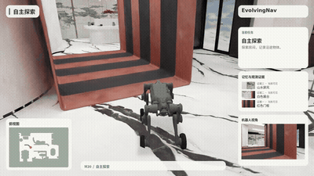
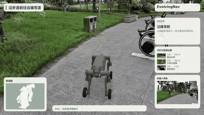
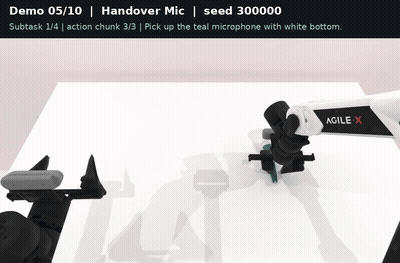
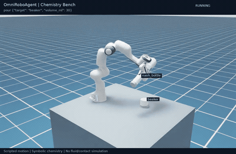
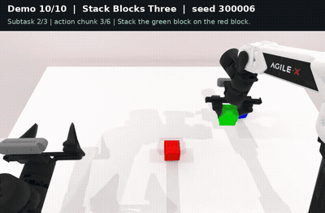
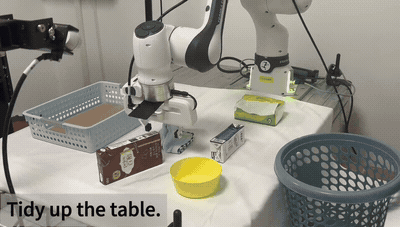
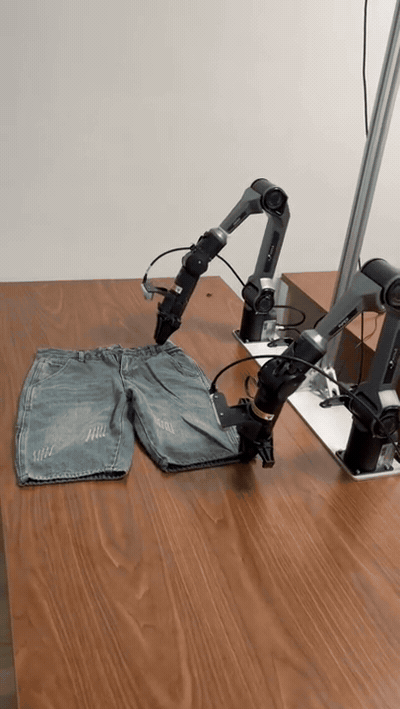
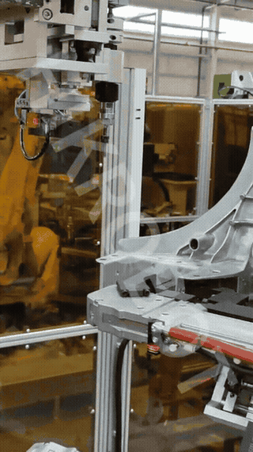

[English](demo-gallery.md) · [简体中文](demo-gallery.zh-CN.md)

# Demonstrations

Navigation clips visualize physical robot trajectories. RoboTwin and chemistry are simulations. Tabletop tidying and folding show physical robot operations. Click a preview to watch the recording.

<table>
<tr><td width="50%" valign="top"><strong>M20 indoor navigation</strong>   Physical robot trajectory replay with exploration, memory and goal arrival. <a href="assets/demos/m20-indoor-en.mp4">Watch full video</a></td><td width="50%" valign="top"><strong>M20 outdoor navigation</strong>   Physical robot trajectory replay with path following and scene observations. <a href="assets/demos/m20-outdoor-en.mp4">Watch full video</a></td></tr>
<tr><td width="50%" valign="top"><strong>RoboTwin dual-arm handover</strong>   Dual-arm simulation: establish the receiving grasp before release. <a href="assets/demos/robotwin_handover_mic.mp4">Watch full video</a></td><td width="50%" valign="top"><strong>Chemistry titration simulation</strong>   Scripted Isaac Sim workflow: pick, pour, inspect color and return. <a href="assets/demos/chemistry-titration.mp4">Watch full video</a></td></tr>
<tr><td width="50%" valign="top"><strong>RoboTwin block stacking</strong>   Dual-arm simulation with red, green and blue blocks. <a href="assets/demos/robotwin_stack_blocks_three.mp4">Watch full video</a></td><td width="50%" valign="top"><strong>Physical robot tabletop tidying</strong>   Pick packages and containers into a storage area. <a href="assets/demos/robot-arm.mp4">Watch full video</a></td></tr>
<tr><td width="50%" valign="top"><strong>Physical dual-arm folding</strong>   Coordinated pulling, folding and placement. <a href="assets/demos/topic3-media5.mp4">Watch full video</a></td><td width="50%" valign="top"><strong>Vision-guided assembly</strong>   Three-dimensional localization for threaded insert assembly. <a href="assets/demos/topic4-media5.mp4">Watch full video</a></td></tr>
</table>

See the [atomic-skill examples](atomic-skills.md) and the [integrated project console](https://liutong-luban-project.netlify.app/offline/) for task graphs and module interaction.
