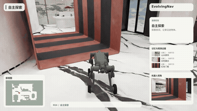
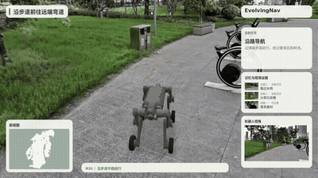
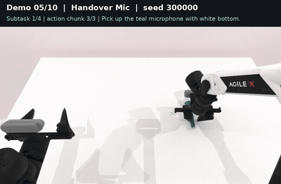
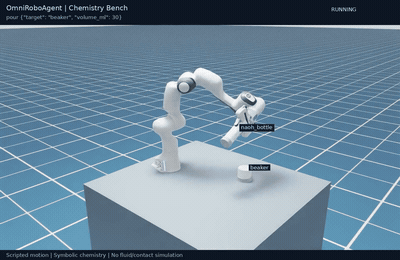
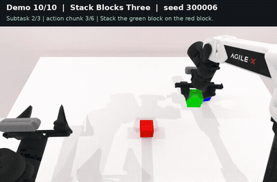
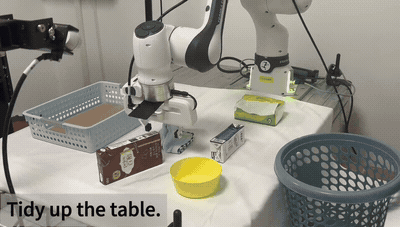
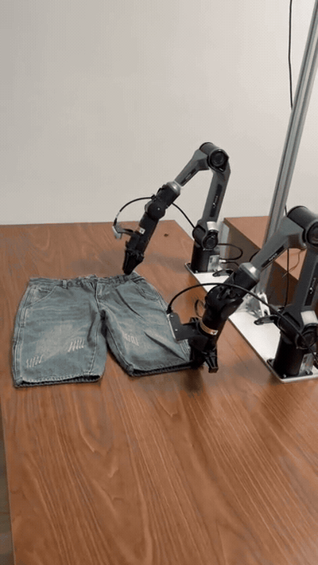
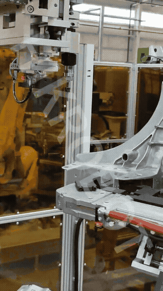

[English](demo-gallery.md) · [简体中文](demo-gallery.zh-CN.md)

# 演示资料

导航画面为真机轨迹可视化回放，RoboTwin 与化学任务为仿真，桌面整理和叠衣为真机操作。点击预览可播放完整录像。

<table>
<tr><td width="50%" valign="top"><strong>M20 室内导航</strong>   真机轨迹可视化回放，展示探索、记忆与目标到达。 <a href="assets/demos/m20-indoor-zh.mp4">观看完整视频</a></td><td width="50%" valign="top"><strong>M20 室外导航</strong>   真机轨迹可视化回放，展示沿路行进与场景观察。 <a href="assets/demos/m20-outdoor-zh.mp4">观看完整视频</a></td></tr>
<tr><td width="50%" valign="top"><strong>RoboTwin 双臂交接</strong>   双臂仿真，先建立接握，再释放供给侧夹爪。 <a href="assets/demos/robotwin_handover_mic.mp4">观看完整视频</a></td><td width="50%" valign="top"><strong>化学滴定仿真</strong>   Isaac Sim 预设流程，取瓶、倾倒、观察显色并归位。 <a href="assets/demos/chemistry-titration.mp4">观看完整视频</a></td></tr>
<tr><td width="50%" valign="top"><strong>RoboTwin 积木堆叠</strong>   双臂仿真，依次堆叠红、绿、蓝积木。 <a href="assets/demos/robotwin_stack_blocks_three.mp4">观看完整视频</a></td><td width="50%" valign="top"><strong>真机桌面整理</strong>   抓取包装与容器并放入收纳区。 <a href="assets/demos/robot-arm.mp4">观看完整视频</a></td></tr>
<tr><td width="50%" valign="top"><strong>真机双臂叠衣</strong>   双臂协同牵引、翻折与放置。 <a href="assets/demos/topic3-media5.mp4">观看完整视频</a></td><td width="50%" valign="top"><strong>视觉引导装配</strong>   三维定位引导螺纹套装配。 <a href="assets/demos/topic4-media5.mp4">观看完整视频</a></td></tr>
</table>

原子技能示例见[技能展示](atomic-skills.zh-CN.md)，任务图与模块联动见[项目演示控制台](https://liutong-luban-project.netlify.app/offline/)。
