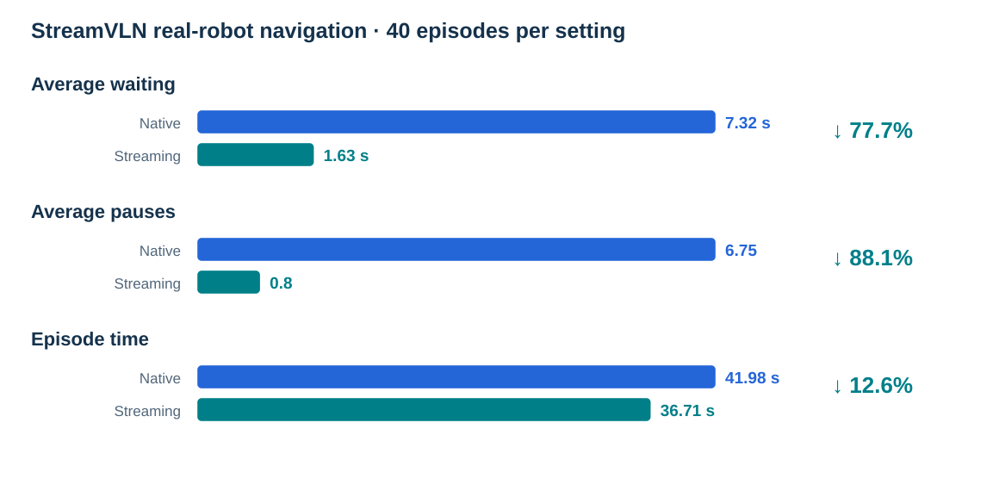
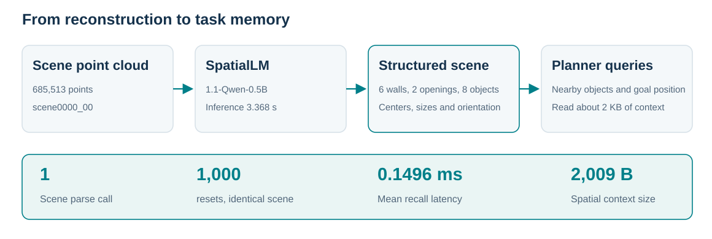

[English](reported-results.md) · [简体中文](reported-results.zh-CN.md)

# Evaluation results and settings

The tables summarize the technical report. Public methods retain their training and test settings. Sample counts, execution budgets and metric definitions follow below.

### RoboCasa365

| Method | Atomic seen (%) | Composed seen (%) | Composed unseen (%) |
| --- | --- | --- | --- |
| DP | 15.7 | 0.2 | 1.3 |
| π0 | 34.6 | 6.1 | 1.1 |
| π0.5 | 39.6 | 7.1 | 1.2 |
| GR00T-N1.6 | 51.1 | 9.4 | 1.7 |
| XR-1 | 80.2 | 57.1 | 32.1 |
| Luban / XR-1 (w/o evolution) | 82.1 | 65.0 | — |
| Luban / XR-1 | 85.5 | 68.6 | — |

### RoboTwin 2.0

| Method | Training | Clean (%) | Random (%) |
| --- | --- | --- | --- |
| π0.5 | Multi-task | 70.70 | 46.00 |
| Luban / Qwen + π0.5 | Multi-task | 61.58 | — |
| DP3 | Single-task | 55.24 | 4.96 |
| π0 | Single-task | 46.42 | 16.34 |
| RDT-1B | Single-task | 34.50 | 13.72 |
| ACT | Single-task | 29.74 | 1.74 |
| DP | Single-task | 28.04 | 0.64 |

### LIBERO

| Method | Spatial (%) | Object (%) | Goal (%) | LIBERO-10 (%) | Mean (%) |
| --- | --- | --- | --- | --- | --- |
| DP | 78.3 | 92.5 | 68.3 | 50.5 | 72.4 |
| OpenVLA | 84.7 | 88.4 | 79.2 | 53.7 | 76.5 |
| π0 | 96.8 | 98.8 | 95.8 | 85.2 | 94.2 |
| OpenVLA-OFT (without Agent) | 97.6 | 97.4 | 98.4 | 93.4 | 96.7 |
| Luban / OpenVLA-OFT | 99.4 | 99.2 | 99.4 | 97.6 | 98.9 |

## RoboCasa365 · XR-1

| Setting | Composite seen success | Atomic seen success |
| --- | ---: | ---: |
| XR-1 baseline | 57.1% | 80.2% |
| Framework without self-evolution | 65.0% | 82.1% |
| Framework with self-evolution | 68.6% | 85.5% |

Source: presentation `results.html`, `js/i18n.js` and README report notes;
atomic-seen baseline corrected in that source on 2026-10-06. Self-evolution changes
reported composite-seen success by +3.6 percentage points and atomic-seen success
by +3.4 percentage points relative to the no-evolution setting.

The supplied summary does not give the task/episode counts, seeds or statistical
tests for these three RoboCasa settings. Those details are not inferred from other
historical campaigns. No unseen result is added.

## LIBERO · OpenVLA-OFT

The report compares **Without Agent** and **Agent**, using four suites, 40 tasks,
50 original episode IDs per task, seed 7 and suite-specific OpenVLA-OFT weights.
The original comparison set contains 2,000 episode IDs.

| Suite | Without Agent | Agent |
| --- | ---: | ---: |
| libero_goal | 98.4% | 99.4% |
| libero_spatial | 97.6% | 99.4% |
| libero_object | 97.4% | 99.2% |
| libero_10 | 93.4% | 97.6% |
| **Overall** | **96.7%** | **98.9%** |

### Metric definition and execution budget

For each original episode ID, assign 1 if at least one execution record associated
with that ID has a successful outcome, otherwise 0. Divide the sum by the number
of original episode IDs. Each ID contributes at most once to the numerator.

| Suite | Original episode IDs | Without Agent: completed IDs | Agent: completed IDs |
| --- | ---: | ---: | ---: |
| libero_goal | 500 | 492 | 497 |
| libero_spatial | 500 | 488 | 497 |
| libero_object | 500 | 487 | 496 |
| libero_10 | 500 | 467 | 488 |
| **Overall** | **2,000** | **1,934** | **1,978** |

Without Agent: 1,934 / 2,000 = 96.7%, based on 2,000 executions.
Agent: 1,978 / 2,000 = 98.9%, based on 2,066 executions in the supplied report.
The two columns therefore use different execution budgets. These values do not
establish an equal-budget, single-execution comparison or a new independent run
of this package.

Source: the presentation's `results.html` and its 2026-10-04 report record,
`assets/evidence/libero-oft-replay-20261004.json`. The report values and their
underlying counts are retained; no new experiment is inferred.

Project source: [Project presentation](https://github.com/yuliu-ai/OmniRoboAgent-Page).
This package’s runnable GPU entry is the [episode guide](episodes.md).

## RoboTwin 2.0 and RoboSynChallenge

The 2026-10-13 website includes two supplied reports. RoboTwin 2.0 uses demo_clean, 50 tasks and 100 episodes per task: 3,079 successes out of 5,000 episodes (61.58%). The configuration uses a Qwen3.5-9B LoRA planner and shared multi-task π0.5 policy, from branch omniagent/robotwin-integration at commit 52d8a314e3679ba1cc6d2b0ecaf3caf11bfd313e.

RoboSynChallenge uses the random setting, seeds 0–99 per task and 10 tasks: 412 successes out of 1,000 episodes (41.2%). It uses Qwen3.5-9B visual planning/verification and public task-specific ACT checkpoints. See the [2026-10-12 branch report](https://github.com/choucaicai/OmniRoboAgent/blob/c9901442c396741fc3d30b73d7e6f058af09ca08/docs/robosynchallenge-results.md). This benchmark is separate from the earlier fixed-titration Isaac Sim demonstration.

Complete task values remain in the website's assets/evidence/robotwin-results-20261009.json and robosynchallenge-results-20261012.json. These existing report results were not rerun in this repository. See the [spatial memory report](spatial-memory-report.md) for scene records and interface timing.

## Additional technical-report results

The Uniubi quadruped has 40 episodes per setting. Streaming execution reduces mean waiting time from 7.32 s to 1.63 s, pauses from 6.75 to 0.80, and episode time from 41.98 s to 36.71 s. End@2m is 15/40 versus 16/40, with no statistically significant endpoint-accuracy improvement reported.

After 1,000 resets, the global-scene content remains unchanged and the total backend-call count remains 1. The spatial context supplied to Planner is 2,009 B. Recall timing measures access to parsed results, separately from model inference. See the [technical-report evidence](assets/evidence/technical-report-results-20261021.json).

## Independent atomic-call and composition evaluation

Three controlled-simulation rounds were completed on 2026-10-28 with the independent evaluator's v2.5 configuration. Each round calls all 64 atomic skills and 25 compositions 50 times, giving 150 trials per item. Atomic trials require actual execution and independent verification; compositions are scored as complete programs. Automatic retries are zero, and historical results are excluded from the denominators.

| Round | Atomic passed / attempted | Lowest atomic rate | Compositions passed / attempted | Lowest composition rate |
| --- | ---: | ---: | ---: | ---: |
| 1 | 3,194 / 3,200 | 98% | 1,249 / 1,250 | 98% |
| 2 | 3,197 / 3,200 | 98% | 1,250 / 1,250 | 100% |
| 3 | 3,191 / 3,200 | 96% | 1,250 / 1,250 | 100% |
| Total | **9,582 / 9,600 (99.81%)** | **96% minimum per round** | **3,749 / 3,750 (99.97%)** | **98% minimum per round** |

Every atomic skill exceeds 90% in every round; every composition reaches at least 60%. All 9,600 independent atomic invocation IDs are unique. The 18 atomic failures and one composition failure are retained. The tested source is `3fa6814880d95c7dcec71435f00b7f2234cc8265`, using two 48 GB-class GPUs and eight simulation workers. Results apply to the declared controlled inputs and state conditions: P06 covers color and shape, P09 covers cabinet-door opening/closing, and native compositions include repeated executions from fixed initial states.

[Per-item counts and three-round protocol](assets/evidence/atomic-call-results-20261028.json) · [Full external evaluation report](https://github.com/yuliu-ai/atomic-skill-evaluator/blob/main/validation/new-machine-20261028/report.md) · [64-GIF gallery](atomic-skills.md)

## Planning, experience and execution efficiency from the technical report

The following results come from sections 4.2.2, 4.2.3, 4.2.4, 4.3 and 4.4.5 of the supplied technical report. They are existing experiments. Values, sample units and table references are retained in the [report excerpts](assets/evidence/technical-report-excerpts-20261028.json).

### RoboTwin planning quality

| Metric | Evaluation unit | Result |
| --- | --- | ---: |
| Parseable structured plans | 248 / 250 plans | 99.20% |
| Exact subtask-count match | 250 plans | 80.40% |
| Exact skill match | 785 aligned slots | 88.28% |
| Instruction / success-condition token-F1 | 785 aligned slots | 81.53% / 81.13% |
| Exact per-subtask budget match | 785 aligned slots | 79.87% |
| Exact full budget-sequence match | 250 plans | 74.00% |
| Per-subtask / total budget MAE | 785 slots / 248 parseable plans | 0.222 / 0.726 action chunks |
| Full-plan exact match across all fields | 250 plans | 33.60% |

These metrics measure agreement with reference plans. Task completion is evaluated using each environment's native success criterion.

### Paired RoboCasa experience retrieval

Across 470 valid paired episodes, control succeeds in 278 (59.15%) and experience retrieval in 294 (62.55%), a net gain of 16 successes or 3.40 percentage points. The paired outcomes retain both improvements and regressions.

| Control outcome | Experience succeeds | Experience fails | Total |
| --- | ---: | ---: | ---: |
| Success | 212 | 66 | 278 |
| Failure | 82 | 110 | 192 |
| Total | 294 | 176 | 470 |

A separate recovery comparison starts from the same 172 initially failed episodes: closed-loop retry recovers 76 (44.19%), while experience-injected retry recovers 69 (40.12%). The effect of experience depends on task conditions and intervention stage.

### LIBERO changes by suite

| Suite | Without Agent | Agent | Difference (percentage points) |
| --- | ---: | ---: | ---: |
| Goal | 492 / 500 (98.4%) | 497 / 500 (99.4%) | +1.0 |
| Spatial | 488 / 500 (97.6%) | 497 / 500 (99.4%) | +1.8 |
| Object | 487 / 500 (97.4%) | 496 / 500 (99.2%) | +1.8 |
| LIBERO-10 | 467 / 500 (93.4%) | 488 / 500 (97.6%) | +4.2 |
| Total | 1,934 / 2,000 (96.7%) | 1,978 / 2,000 (98.9%) | +2.2 |

The existing original-episode-ID definition above is retained, including the different execution budgets of 2,000 versus 2,066 executions.

### Physical-robot navigation continuity

The Uniubi quadruped uses 40 episodes per setting, with eight instructions repeated five times. Waiting, pauses and timing follow report Table 12-4; End@2m records endpoint arrival.

| Policy and setting | Mean waiting (s) | Waiting share | Pauses | Episode time (s) | End@2m |
| --- | ---: | ---: | ---: | ---: | ---: |
| Native StreamVLN | 7.32 | 17.4% | 6.75 | 41.98 | 15 / 40 |
| StreamVLN + streaming execution | 1.63 | 4.4% | 0.80 | 36.71 | 16 / 40 |
| Native NaVIDA | 10.64 | 30.5% | 9.25 | 34.90 | 12 / 40 |
| NaVIDA + streaming execution | 2.89 | 10.3% | 1.20 | 28.06 | 12 / 40 |

Mean waiting decreases by 77.7% for StreamVLN and 72.8% for NaVIDA. Endpoint counts remain visible and are evaluated separately from waiting-time reductions.
