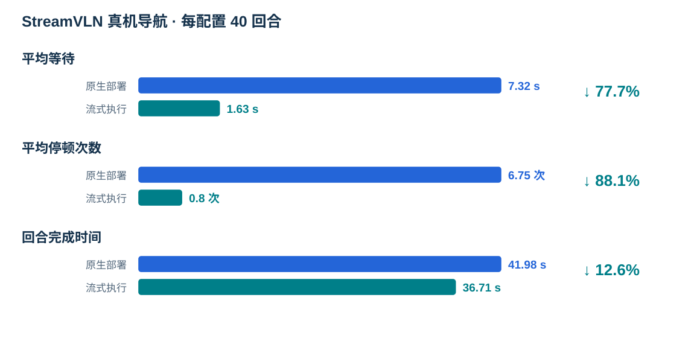
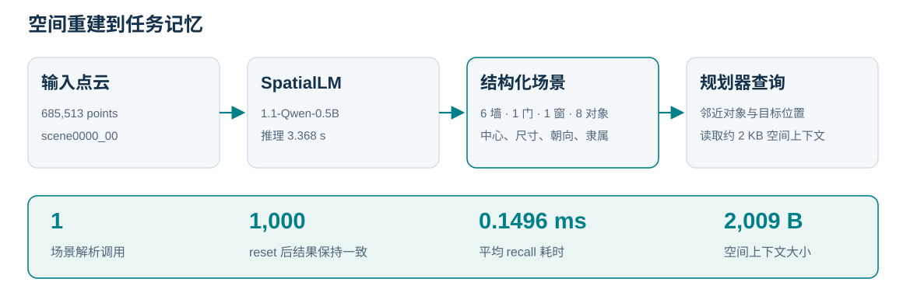

[English](reported-results.md) · [简体中文](reported-results.zh-CN.md)

# 实验结果与评测设置

下表汇总技术报告中的基准结果，公开方法保留对应训练与测试设置。详细样本数、执行预算和指标定义见下文。

### RoboCasa365

| 方法 | Atomic seen (%) | Composed seen (%) | Composed unseen (%) |
| --- | --- | --- | --- |
| DP | 15.7 | 0.2 | 1.3 |
| π0 | 34.6 | 6.1 | 1.1 |
| π0.5 | 39.6 | 7.1 | 1.2 |
| GR00T-N1.6 | 51.1 | 9.4 | 1.7 |
| XR-1 | 80.2 | 57.1 | 32.1 |
| 六通智能体 / XR-1 （无自进化） | 82.1 | 65.0 | — |
| 六通智能体 / XR-1 | 85.5 | 68.6 | — |

### RoboTwin 2.0

| 方法 | 训练设置 | Clean (%) | Random (%) |
| --- | --- | --- | --- |
| π0.5 | 多任务联合训练 | 70.70 | 46.00 |
| 六通智能体 / Qwen + π0.5 | 多任务联合训练 | 61.58 | — |
| DP3 | 单任务微调 | 55.24 | 4.96 |
| π0 | 单任务微调 | 46.42 | 16.34 |
| RDT-1B | 单任务微调 | 34.50 | 13.72 |
| ACT | 单任务微调 | 29.74 | 1.74 |
| DP | 单任务微调 | 28.04 | 0.64 |

### LIBERO

| 方法 | Spatial (%) | Object (%) | Goal (%) | LIBERO-10 (%) | 平均 (%) |
| --- | --- | --- | --- | --- | --- |
| DP | 78.3 | 92.5 | 68.3 | 50.5 | 72.4 |
| OpenVLA | 84.7 | 88.4 | 79.2 | 53.7 | 76.5 |
| π0 | 96.8 | 98.8 | 95.8 | 85.2 | 94.2 |
| OpenVLA-OFT (without Agent) | 97.6 | 97.4 | 98.4 | 93.4 | 96.7 |
| 六通智能体 / OpenVLA-OFT | 99.4 | 99.2 | 99.4 | 97.6 | 98.9 |

## RoboCasa365 · XR-1

| 设置 | Composite seen 成功率 | Atomic seen 成功率 |
| --- | ---: | ---: |
| XR-1 基线 | 57.1% | 80.2% |
| 无自进化 | 65.0% | 82.1% |
| 有自进化 | 68.6% | 85.5% |

来源为展示页 `results.html`、`js/i18n.js` 与 README 报告说明，Atomic seen 基线于源文件
2026-10-06 更正。有自进化相对无自进化的报告差值：Composite seen +3.6 个百分点，
Atomic seen +3.4 个百分点。

已有摘要未提供这三组 RoboCasa 的任务／回合数、seed 或统计检验，不从其他历史实验推填，
也不新增 unseen 结果。

## LIBERO · OpenVLA-OFT

统一使用 **Without Agent** 与 **Agent**。四个套件、40 个任务，每任务 50 个原始回合 ID，
seed 7，各套件使用对应 OpenVLA-OFT 微调权重。原始对比集共 2,000 个回合 ID。

| 套件 | Without Agent | Agent |
| --- | ---: | ---: |
| libero_goal | 98.4% | 99.4% |
| libero_spatial | 97.6% | 99.4% |
| libero_object | 97.4% | 99.2% |
| libero_10 | 93.4% | 97.6% |
| **整体** | **96.7%** | **98.9%** |

### 指标定义与执行预算

每个原始回合 ID 至少有一条成功执行记录则计为 1，否则计为 0；总和除以原始 ID 数。
同一 ID 在分子中最多计一次。

| 套件 | 原始 ID 数 | Without Agent：完成 ID 数 | Agent：完成 ID 数 |
| --- | ---: | ---: | ---: |
| libero_goal | 500 | 492 | 497 |
| libero_spatial | 500 | 488 | 497 |
| libero_object | 500 | 487 | 496 |
| libero_10 | 500 | 467 | 488 |
| **整体** | **2,000** | **1,934** | **1,978** |

Without Agent 为 1,934 / 2,000 = 96.7%，基于 2,000 次执行。
Agent 为 1,978 / 2,000 = 98.9%，基于原报告的 2,066 次执行。
两列执行预算不同，不建立等预算单次执行对比，也不代表本包的新独立实验。

来源为展示页 `results.html` 与 2026-10-04 报告记录
`assets/evidence/libero-oft-replay-20261004.json`，保留原值及底层计数。
项目来源：[项目展示页](https://github.com/yuliu-ai/OmniRoboAgent-Page)。
本包 GPU 运行入口见[回合指南](episodes.zh-CN.md)。

## RoboTwin 2.0 与 RoboSynChallenge

2026-10-13 展示页已接入两组报告。RoboTwin 2.0 使用 demo_clean 设置、50 个任务、每任务 100 回合，共 5,000 回合，3,079 次成功，成功率 61.58%。配置为 Qwen3.5-9B LoRA 规划器与共享多任务 π0.5 策略，来源分支 omniagent/robotwin-integration，commit 52d8a314e3679ba1cc6d2b0ecaf3caf11bfd313e。

RoboSynChallenge 使用 random 设置，每个任务 seeds 0–99，10 个任务共 1,000 回合，412 次成功，成功率 41.2%。采用 Qwen3.5-9B 视觉规划与验证、公开的任务专用 ACT checkpoint，来源为 [2026-10-12 分支结果](https://github.com/choucaicai/OmniRoboAgent/blob/c9901442c396741fc3d30b73d7e6f058af09ca08/docs/robosynchallenge-results.md)。该基准与原 Isaac Sim 固定滴定演示分别记录。

两组完整逐任务值保留在展示页 assets/evidence/ 的 robotwin-results-20261009.json 与 robosynchallenge-results-20261012.json。以上属于既有报告，未在本仓库重新执行。空间模块的场景记录与接口计时见[空间记忆报告](spatial-memory-report.zh-CN.md)。

## 科技报告补充结果

Uniubi 机器狗每种设置各测试 40 回合。流式执行使平均等待时间从 7.32 s 降至 1.63 s，停顿次数从 6.75 次降至 0.80 次，回合时长从 41.98 s 降至 36.71 s。End@2m 为 15/40 与 16/40，现有结果未显示统计显著的终点精度提升。

全局空间场景在 1,000 次 reset 后保持相同内容，后端调用累计仍为 1 次，供 Planner 读取的空间上下文为 2,009 B。recall 计时衡量已解析结果的读取，模型推理耗时另计。数据来源见[科技报告结果记录](assets/evidence/technical-report-results-20261021.json)。

## 原子技能独立调用与组合评测

2026-10-28在独立评测包v2.5配置下完成三轮受控仿真评测，每轮64项原子技能与25组组合各调用50次，每项累计150次。原子技能按单次调用的实际执行与独立验证计分，组合按完整程序计分，自动重试为0，旧版本结果不进入本次分母。

| 轮次 | 原子技能通过 / 调用 | 原子最低单项率 | 组合通过 / 调用 | 组合最低单项率 |
| --- | ---: | ---: | ---: | ---: |
| 1 | 3,194 / 3,200 | 98% | 1,249 / 1,250 | 98% |
| 2 | 3,197 / 3,200 | 98% | 1,250 / 1,250 | 100% |
| 3 | 3,191 / 3,200 | 96% | 1,250 / 1,250 | 100% |
| 合计 | **9,582 / 9,600（99.81%）** | **逐轮最低96%** | **3,749 / 3,750（99.97%）** | **逐轮最低98%** |

全部原子技能各轮严格大于90%，全部组合各轮不低于60%。9,600个独立原子调用编号唯一，18次原子失败和1次组合失败均保留。评测源码固定为`3fa6814880d95c7dcec71435f00b7f2234cc8265`，使用两张48GB级GPU和8路仿真并发。结果覆盖预先声明的受控输入与状态条件，其中P06测试颜色与形状，P09测试柜门开合，原生组合包含固定初态重复执行。

[逐项计数与三轮协议](assets/evidence/atomic-call-results-20261028.json) · [完整外部评测报告](https://github.com/yuliu-ai/atomic-skill-evaluator/blob/main/validation/new-machine-20261028/report.md) · [64项动图库](atomic-skills.zh-CN.md)

## 科技报告的规划、经验与执行效率

以下内容对应用户提供科技报告的第4.2.2、4.2.3、4.2.4、4.3和4.4.5节，属于既有实验结果。数值、样本单位与表号保存在[报告数据摘录](assets/evidence/technical-report-excerpts-20261028.json)。

### RoboTwin规划质量

| 指标 | 评价规模 | 结果 |
| --- | --- | ---: |
| 结构化计划可解析率 | 248 / 250条计划 | 99.20% |
| 子任务数量完全匹配率 | 250条计划 | 80.40% |
| 技能完全匹配率 | 785个对齐槽位 | 88.28% |
| 指令 / 成功条件 token-F1 | 785个对齐槽位 | 81.53% / 81.13% |
| 逐子任务预算完全匹配率 | 785个对齐槽位 | 79.87% |
| 整条预算序列完全匹配率 | 250条计划 | 74.00% |
| 逐子任务 / 总预算 MAE | 785个槽位 / 248条可解析计划 | 0.222 / 0.726个动作块 |
| 整条计划逐字段完全一致 | 250条计划 | 33.60% |

这些指标衡量规划与参考标注的一致程度，整任务完成仍采用环境原生成功判据。

### RoboCasa经验检索配对

470对共同有效回合中，对照组成功278次（59.15%），经验组成功294次（62.55%），净增加16次成功，即3.40个百分点。配对结局保留改善与退化两种方向。

| 对照组结局 | 经验组成功 | 经验组失败 | 合计 |
| --- | ---: | ---: | ---: |
| 成功 | 212 | 66 | 278 |
| 失败 | 82 | 110 | 192 |
| 合计 | 294 | 176 | 470 |

另一组以相同172个初测失败回合为起点的恢复实验中，闭环重试恢复76次（44.19%），经验注入重试恢复69次（40.12%）。经验辅助的效果依赖任务条件与介入阶段。

### LIBERO按套件的变化

| 套件 | Without Agent | Agent | 差值（百分点） |
| --- | ---: | ---: | ---: |
| Goal | 492 / 500（98.4%） | 497 / 500（99.4%） | +1.0 |
| Spatial | 488 / 500（97.6%） | 497 / 500（99.4%） | +1.8 |
| Object | 487 / 500（97.4%） | 496 / 500（99.2%） | +1.8 |
| LIBERO-10 | 467 / 500（93.4%） | 488 / 500（97.6%） | +4.2 |
| 合计 | 1,934 / 2,000（96.7%） | 1,978 / 2,000（98.9%） | +2.2 |

沿用本页已有的原始回合ID统计定义，执行次数为2,000与2,066，保留不同执行预算的说明。

### 真机导航的等待与连续性

Uniubi机器狗每种设置40回合，包含8条指令各5次重复。表内等待、停顿与耗时对应报告表12-4，End@2m衡量最终到达结果。

| 策略与设置 | 平均等待（秒） | 等待占比 | 停顿次数 | 回合时间（秒） | End@2m |
| --- | ---: | ---: | ---: | ---: | ---: |
| StreamVLN原生 | 7.32 | 17.4% | 6.75 | 41.98 | 15 / 40 |
| StreamVLN加流式执行 | 1.63 | 4.4% | 0.80 | 36.71 | 16 / 40 |
| NaVIDA原生 | 10.64 | 30.5% | 9.25 | 34.90 | 12 / 40 |
| NaVIDA加流式执行 | 2.89 | 10.3% | 1.20 | 28.06 | 12 / 40 |

StreamVLN平均等待降低77.7%，NaVIDA降低72.8%。到达成功数单独保留，等待减少与到达精度分别评价。
