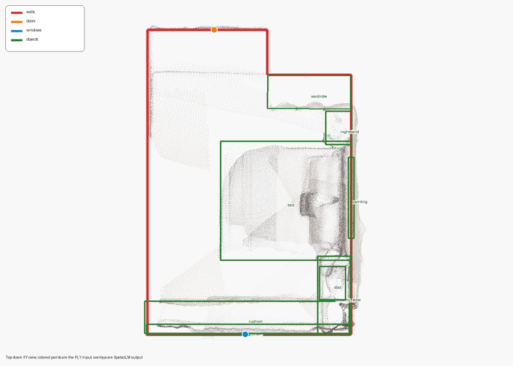

[English](spatial-memory-report.md) · [简体中文](spatial-memory-report.zh-CN.md)

# Spatial reconstruction and memory report

Prepared on 2026-10-18 from the supplied document `2.3 空间重建与空间记忆.docx`. Measurements come from its recorded project scene run and interface replay experiment. No GPU inference was rerun for this website edit. SpatialLM paper results on public datasets are not listed as Luban evaluations.

## Scene parsing

Scene scene0000_00 contains 685,513 points. The recorded setup uses SpatialLM1.1-Qwen-0.5B, an RTX 4090 D, bfloat16 and seed 42. Output comprises 6 walls, 1 door, 1 window and 8 objects, totaling 16 entities. Loading takes 2.893 s, inference 3.368 s and total execution 6.418 s. Objects retain categories, centers, sizes and orientations. Openings reference walls through wall_id.

## Memory replay

Saved structured results are replayed through the memory interface in 5 groups of 10,000 recall calls each. Reported mean latency is 0.1496 ms with 0.0003 ms standard deviation and 2,009 B scene context. Global-scene initialization calls the backend once. After 1,000 resets the count remains one and output is unchanged. Recall timing covers structured reads and excludes model inference.

The current [SpatialMemory implementation](../src/luban/agent_core/memories/spatial.py) parses global_scene_ply at initialization, retains its result across resets and returns a copied spatial context through recall. Online mode clears its fused map at reset. Upstream poses and external SpatialLM dependencies still require configuration.

## Application materials

The supplied Topic 3 slides show navigation and manipulation across embodiments. Topic 5 slides and Zhongkong materials provide traffic robot, tunnel quadruped and highway drone examples. The local website selects three 35-second excerpts and retains source attribution. Recognition rates, transfer times and task success rates from those materials are not presented as Luban benchmark results.
