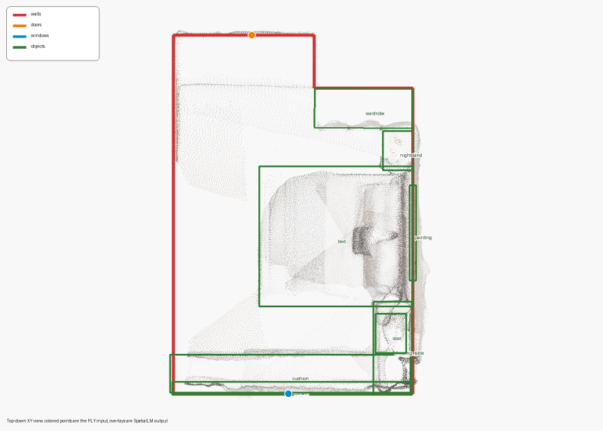

[English](spatial-memory-report.md) · [简体中文](spatial-memory-report.zh-CN.md)

# 空间重建与空间记忆报告

2026-10-18 根据用户提供的《2.3 空间重建与空间记忆.docx》整理。以下数值来自材料中的项目单场景记录和接口回放实验，本次网站编辑没有重新运行 GPU 推理。公开数据集上的 SpatialLM 论文结果未列为 六通智能体 自测结果。

## 场景解析

场景 scene0000_00 含 685,513 个点，模型 SpatialLM1.1-Qwen-0.5B，RTX 4090 D，bfloat16，seed 42。输出包括 6 面墙、1 扇门、1 扇窗和 8 个对象，共 16 个实体。加载耗时 2.893 s，推理耗时 3.368 s，总耗时 6.418 s。对象保存类别、中心、尺寸与朝向，门窗通过 wall_id 关联墙体。

## 记忆回放

使用保存的结构化结果回放记忆接口，5 组实验各调用 recall 10,000 次。报告平均耗时 0.1496 ms，标准差 0.0003 ms，场景上下文为 2,009 B。全局场景初始化调用后端 1 次，1,000 次 reset 后仍为 1 次，输出保持一致。该计时衡量结构化结果读取，不包含模型推理。

当前 [SpatialMemory](../src/luban/agent_core/memories/spatial.py) 在配置 global_scene_ply 时初始化解析并保留全局结果，reset 还原该结果，recall 返回空间上下文副本。在线模式在 reset 时清空融合地图。上游位姿与外部 SpatialLM 依赖仍需由使用者配置。

## 应用素材

《课题三-深圳研讨会v0.pptx》提供跨本体导航与操作场景，《课题5：面向极端环境自主探索的具身智能体.pptx》与中控素材提供交通机器人、隧道机器狗、公路无人机示例。本地展示页选取三个 35 秒视频节选，保留原始标识和来源文件名。素材中的识别率、迁移用时和任务成功率不作为 六通智能体 框架实验结果。
